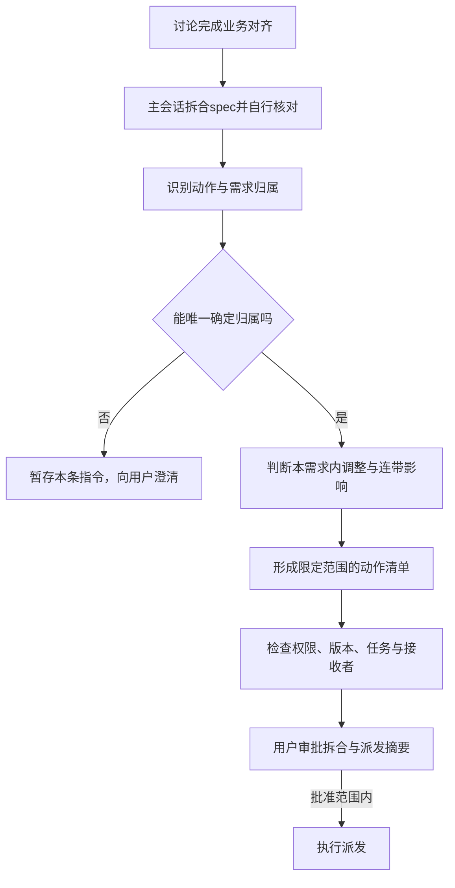

# 需求确认、spec自核对与派工路由开发规格

状态：业务细节在讨论中确认，主会话自行核对spec；用户审批拆合与派发摘要后才下发，不要求用户逐行复审spec。本批次两项拆合与派发摘要已由用户明确批准；后续变更按影响范围重新判断。

日期：2026-11-01（北京时间）。参考代码基线：`4fcfe37940f19b06621a78b6298732d8d51f27b0`。

配套文件：[验收清单与误派回归案例](../acceptance/demand-driven-routing-checklist.md)。

## 1. 本需求要解决什么

用户的一条需求调整，应先归属具体需求，再决定由谁执行、允许影响谁。不能因为几个 agent 熟悉相关模块，就向它们广播调整或重排整个项目。

本任务（ROUTING-INTAKE）落实讨论收口、spec自核对、按需求派工和指令影响检查。与其独立的完成、取消及资源回收实现交给 生命周期任务 DEV-LIFECYCLE，不因一条用户消息就机械拆任务，也不按模块派固定agent。

顺序固定为：用户提出需求 → 主会话讨论细化并完成业务对齐 → 主会话提出拆合后的spec方案并自核对 → 用户审批简明拆合与派发摘要 → 每个获批spec对应一个开发任务、一个工作树、一个开发agent和一个PR。用户判断摘要中的拆合是否合理，不需要自行撰写拆分方案或逐行复审spec。其它在途任务保持原范围；Git、合并和部署权限按实际授权分别记录。

## 2. 角色与责任

| 角色 | 存续方式 | 负责什么 |
| --- | --- | --- |
| 主 agent | 长期，用户唯一入口 | 需求讨论、只读分析、指令归属、派工说明、用户决策和验收 |
| 集成 agent | 长期 | 非作者审核、CI、合并、已授权发布部署；核实并转交范围内的技术依赖 |
| 开发 agent | 随一个明确需求创建和结束 | 该需求的完整实现、自测、返工、同步最新 main、维护同一个 MR/PR |

不设置长期的核心、资源、前端或独立审核 agent。只读查询、资料检索、解释和分析由主 agent 处理；集成审核是集成角色的工作，不额外创建只读审核 agent。

一个开发需求对应一个开发任务、一个工作树、一个开发 agent、一个 MR/PR。同一未完成需求的返工继续使用原对应关系。不能因为 agent 空闲、熟悉同一模块，就让它接另一个需求。

## 3. 需求怎样收口、生成spec和派发

### R0：讨论即确认，spec由主会话核对

用户在讨论中确认的目标、范围、边界和验收方式，就是业务确认依据。主会话在对齐完成后才决定如何拆合spec；能独立交付验收的拆开，强耦合的目标合并。主会话提出方案，由用户通过摘要审批最终spec数量、范围及派发安排。

主会话生成spec后逐项对照已确认讨论，检查遗漏、曲解、矛盾、擅自新增业务选择，以及验收清单是否可验证。不一致就自行修正规格；只有真正尚未明确的业务问题才询问用户。不要求用户逐行复审整份spec；但必须取得用户对拆合与派发摘要的审批，讨论确认和主会话自核对均不能替代这一审批。

最后下发前，主会话必须先在用户原主会话说明最终拆合结果：spec总数、各spec名称和范围、为什么拆开或合并、对应任务新建还是复用开发agent及理由；复用时指出实际agent，新建后补记真实身份。这份摘要是审批材料。用户通过摘要判断拆合与派发是否合理，批准后才可执行；不能先派发再补说明。

记录摘要版本、所含任务和范围、新建或复用安排、原文呈现依据，以及来自用户的明确审批。仅发出摘要不算获批，不能从其它事项的“同意”或worker报告推断用户批准。修改拆合、目标范围或派发安排时，更新受影响摘要并重新审批；未受影响项沿用原审批。只修改不影响已批摘要的技术细节时，由主会话重新核对spec，不重复要求用户审批。

保留讨论依据、spec版本/摘要、核对结果及主会话身份。只有当前spec核对一致、拆合与派发摘要已获用户批准且具备该任务开工授权（含已给出的条件式授权）才能派发；文档被修改后重新核对。核对不等于功能验收，不替代提交、推送、合并或部署权限。

### R1：先确定需求，再确定执行者

优先使用明确的需求名称、MR/PR、引用内容；否则结合当前正在讨论的事项。能唯一判断就直接归属。仍有多个合理候选时，只澄清本条指令，其它任务继续。

普通查询与讨论直接由主 agent 处理，不因提到了一个功能就自动创建任务、工作树或开发 agent。一条消息含多个独立要求时分别归属，不能整条广播给所有人；不明确的部分单独暂存。

### R2：用已确认目标和验收范围区分新旧需求

| 判断 | 动作 |
| --- | --- |
| 达到原目标所需的细节补充、缺陷修复或验收返工 | 交给原未完成需求的开发 agent，沿用工作树与 PR |
| 原范围之外、能够独立验收的新能力 | 主会话讨论确认；具备开工授权后，新建需求、工作树、开发 agent 与 PR |
| 原任务已经交付结束后的新修改 | 新建需求并关联旧记录，不长期挂住原 agent |

表中的细节补充适用于验收前；验收后按 R7冻结范围，只允许原目标下的缺陷返工，新增要求另立需求。

跨多个模块仍可属于同一个需求，由该需求的开发 agent 完整负责。修改同一个文件或模块，不足以证明两个需求存在连带影响。

### R3：派工前说明去向与理由

说明应简短，至少包含需求、复用或新建、执行者和原因。例如：

> 这是路由需求的验收返工，交给该需求原开发 agent，沿用原工作树和 PR，因为目标及验收范围没有改变。

新建前尚无真实 agent 标识时，先说明计划新建及原因；创建后记录实际标识，不预填虚构身份。摘要审批是派发前置条件；它不默认放开未授权的提交、推送、合并或部署，也不要求用户再逐行审核已由主会话核对的spec。

## 4. 影响范围怎样判断

### R4：默认只影响归属需求

一条指令仅能改变其明确归属需求中的明确事项。调整交付方式，不自动改变其它需求的目标、优先级或执行状态。共同使用一个 agent、仓库、模块或资源，不构成影响其它任务的依据。

### R5：有具体依赖才加入跨任务待办

开发 agent 提出依赖请求，写清楚四件事：影响哪个任务、依赖哪个约定或成果、实际发生什么变化、需要对方做什么。

集成 agent 核实技术依据。动作属于双方已确认范围的，就转交原责任者、加入其任务待办，不自动打断原任务。开发 agent 不能直接指挥另一开发 agent，也不能自行重排对方任务。

涉及新增功能、扩大范围或改变用户已确定的优先级时，由主会话向用户确认。影响还要传到第三个任务时，需重新核实下一段依赖，不能沿关系自动扩散。已有审核职责不代表每次交付调整都应立即打断审核者。

### R6：新指令只覆盖明确改变的部分

保留原指令和更新记录，只替换同一需求中明确变更的条件，其余条件继续有效，其它需求不变。例如，新授权允许提交、推送并提 PR，不能自动解除原来的不部署限制。

### R7：验收后冻结范围

验收通过后进入审核、CI和合并，不再自行增加功能或调整设计。集成发现原需求缺陷时，原开发 agent 在原 PR 修复，核验受影响结果；新增要求另立需求。

## 5. 与生命周期任务的边界

本任务决定是否新建/复用开发agent、原需求还是新需求、如何更新作用范围；不重写资源回收内核。每次派发保留需求、实际执行者、工作树、分支和PR绑定，传递现有任务信息供生命周期核验。

主/集成agent长期存在，开发agent随需求结束；完成、取消、保全与回收的具体实现和验证归 生命周期任务 DEV-LIFECYCLE 的独立规格。两项各自基于最新main实现和提PR，不复制对方未合入代码。集成者处理公共入口冲突、同步和回归。

## 6. 开发实现要求

以下是落实已确认规则的技术约束，不增加新的业务选择：

1. 在现有单项目权威账本中扩展，不另建任务队列或第二份任务状态。指令、需求、执行者和资源保持可追溯关联。
2. 指令记录至少能表达原文/来源、动作、归属需求、目标与授权版本、明确更新项；路由结果表达执行者及复用/新建理由。
3. 摘要审批绑定当前计划、任务及范围，在创建或联系开发agent前核验用户来源；未审批、被拒或已过期则不派发，也不影响其它已授权任务。跨任务影响逐项记录目标任务、依赖依据、最小必要动作及核实者。无依据的影响项不能转成派发、改优先级、暂停或取消。
4. 受管派发路径在调用宿主工具前检查上述记录、当前任务归属、版本、权限和接收者。记录变化后重新判断；重复事件不重复创建 agent 或执行动作。校验失败保留原指令并给出具体原因。
5. 模型提出语义判断，集成核实技术依赖，工具检查结构、身份、版本、授权和动作边界。不得宣称工具能自动证明任意自然语言依赖正确。
6. 需求对齐、spec核对、派发、同任务返工及依赖待办复用或扩展正式入口。主会话可在既有授权内自行拆合spec，不能自动扩大已确认业务范围。
7. 同一需求和实际 agent、工作树、MR/PR唯一绑定。未取得实际身份前保持未派发；资源不足沿用准入与排队，不挪用其它需求的开发 agent。
8. 不为spec比对创建只读agent；不让集成者替主会话承担业务讨论一致性确认。正式代码审查仍由非作者集成者完成。
9. 同步现行skill和使用说明，移除逐行复审spec、跳过摘要审批及长期模块派工等错误活动要求；历史记录不改写成新规则通过证明。

现有主要接点是 `core_runtime.py`、`coordination.py`、`delivery.py`、`host_adapter.py`、`merge_gate.py`、`cleanup.py` 及资源桥接层。开发者可复用现有模块，不要求新造通用调度框架；以可观察行为通过验收为准。

当前代码已具备任务授权、收件、合并核对和回收保护。此次重点补足讨论到spec到派发的受管入口及指令影响检查；取消结束点归独立生命周期任务。历史只读任务记录保留追溯，不能作为继续创建只读开发 agent 的理由。

## 7. 范围与交付要求

本需求不包含自动唤醒、后台轮询、全局安装、跨平台通用控制器或其它未确认 issue 的开发，也不批量迁移、改派或清理其它在途任务。当前真实项目接入等既有任务继续按各自范围推进。

验证先覆盖受管入口，再用本需求自身的真实开发、PR和交付链确认作用；不能只给出模拟测试数量。本需求合并后的开发者回收由集成者按可用且已授权的正式流程收尾，不以另一未合任务代码冒认验证，也不为演示新建只读测试agent。

本任务验收项为配套清单 T01—T13、T18—T19、T21—T30；生命周期项 T14—T17、T20另行交付。完成后交付一份PR、源码绑定的回归证据、真实项目执行记录和使用说明。没有观察到真实等待减少时，只报告实际事实，不宣称效率提升。

本规格由主会话对照讨论核对，不请求用户逐行批准文档；最终拆合与派发摘要仍需用户审批。功能是否实现、测试是否通过、PR是否合入分别记录，不能由spec核对结论代替。

## 8. 作者实施记录（2026-11-01）

批准时的原始 spec/checklist 已按 APPROVED_PLAN 指纹另存本任务交付目录的 approved-input；本节只补充实现和证据入口，不改变已批准目标。

实现位于独立 `scripts/demand_routing.py`，通过 `Runtime.routing/routing_status` 共用 canonical 账本。`prepare` 关联需求并拒绝新只读开发任务；`launch(route_id=...)` 在资源准入外检查 spec、摘要审批、唯一指令、当前版本和接收者。`bind_executor(task_id=...)` 保存实际唯一绑定；MR 元数据入口增加同 PR 和跨任务唯一性检查。完成、取消及资源回收引擎未改。

真实开发反馈补充了 `bind_observed_dispatch`：原主控已经实际 spawn，但 pending task 尚未关联 owner 时，受信主/集成以原批准文件、原始派发结果、两份批准文档快照、当前运行观察和 ledger/target 版本登记事实；不重复 spawn/send，不补造资源准入或历史 launch。该入口的参数及严格边界见 [需求路由说明](../../skills/isolated-parallel-development-coordination/references/demand-routing.md)。

作者本地专项测试涵盖配套清单全部 25 个本任务编号、历史误派回放及补充的审批/版本/身份/PR/观察失败边界。模拟宿主调用明确为夹具；真实工作树、用户原批准文档及本任务 Git/PR 交付分别留证。真实 canonical 登记、原生完成事件送达、非作者审核、合并及之后回收须由主控/集成按实际权限核验，不能从本地测试或文件报告推定已发生。最终源码、测试数、跳过项和 PR URL 以工作树外本任务交付报告为准。

R2独审返修：已交付作者的真实idle/completed终态可登记归属；最新终态优先于thread active元数据，不伪记running。终态只进入awaiting_receipt，不结束code任务。新增Runtime.receive_observed_delivery，按原批准的同任务integration收件权限核实真实final引用的作者报告，调用canonical验单和单条消费；不变更coordinator/全局delivery、不填造CI job、不全局drain，也不替代源码校验、验收或合main门禁。原R1失败和源码证据保留，补充终态/受限收件回归见验收清单。
