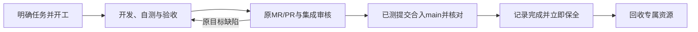

# 开发agent生命周期与资源回收开发规格

任务：DEV-LIFECYCLE。日期：2026-11-01（北京时间）。参考基线：`4fcfe37940f19b06621a78b6298732d8d51f27b0`。

业务依据是主会话已经逐项确认的讨论，由主会话自行核对一致性，不要求用户逐行复审spec；拆合与派发摘要获用户批准后才派发本任务。下文保留批准的业务范围，第7节记录本分支实现契约；是否通过以配套清单和外部源码绑定回归为准。

配套：[本任务验收清单](../acceptance/development-agent-lifecycle-checklist.md)。派工路由任务 ROUTING-INTAKE负责讨论、spec和指令归属，本任务负责执行者绑定、任务结束及回收；各自一个工作树、一个开发agent和一个PR。

## 1. 目标与责任

只有明确且具备开工授权的开发任务才能创建开发agent。开发agent随一个需求存续，合并交付或明确取消后立即保全并回收专属资源，不形成长期模块岗位。

长期角色只有主agent和集成agent。主agent负责用户交互与只读工作；集成agent负责非作者审核、CI、串行合并、已授权部署及技术依赖协调。不为只读排查、文档比对或审核新建开发agent。

本任务不做需求语义路由、spec自核对、自动唤醒、全局安装或其它项目清理。其它在途需求不因本任务而暂停、改派或回收。

## 2. 任务与资源绑定

- 每个spec对应一个开发任务、一个实际开发agent、一个专属工作树和一个MR/PR。分支从最新main建立，原作者负责同步main并维护原PR。
- 同一未完成需求的原目标缺陷返工保留原agent、工作树和PR。验收后冻结范围，新增要求另立需求；交付后的新修改也另立需求、关联旧记录。
- 开发agent不能同时承担多个未完成需求，不能因空闲或熟悉模块接另一个需求。资源不足沿用准入与排队，不抢占其它任务执行者。
- 未取得真实agent、资源或PR身份时不预填虚构对象。保持任务、执行者、工作树和PR唯一绑定，复用现有单项目权威账本，不另建任务队列。

## 3. 正常交付



模型回复完成、测试通过、用户验收通过或PR创建，都不是结束点。集成核对已测提交实际合入目标main后，记录完成，立即触发保全与回收，不等待后续部署。

保全提交号、关键决策、验收结论、必要交接与最小复现证据，放在被清理工作树之外，不能只留在agent记忆中。按归属回收开发agent、专属工作树、任务进程、临时库和验收环境；主/集成agent、共享资源和其它任务仍在使用的资源不属于该任务清理范围。

## 4. 明确取消

用户明确取消未完成需求也是合法结束依据。停止该需求工作，先保全成果，再关闭对应MR/PR并回收专属资源，记录已取消，不伪记完成或合并。没有PR时跳过关闭步骤，不为结束任务造PR或合入main。

取消只影响明确归属需求。集成核实确有依赖的任务受到什么影响，不连带取消。归属或取消含义不明确时先澄清本条指令，其它任务继续。

## 5. 回收核验

- 任务结束与清理完成分开记录；任务可已完成/已取消，但仍有明确的待回收事项。
- 正式关闭并取得核实依据后才记名额释放；空闲、回复完成、超时或仅返回关闭前状态，都不等于真实关闭。
- 逐项记实际结果。失败或未知保留责任者与待回收状态；成功步骤不重做，未知先核对，不盲重发。
- 清理前检查归属、活动工作/后代、共享引用、保全及当前授权，不按旧PID、旧身份或同名目录误清新对象。
- 宿主能力缺失就如实待处理；不以模拟结果证明真实名额、进程或空间已释放。

## 6. 实现与交付

复用现有任务完成、宿主适配、清理和资源桥接正式入口。保留正常合并完成门槛，补充真实取消依据及回收路径；不借取消绕过完成校验，不建立第二份任务状态。

同步现行skill、生命周期和使用说明，移除长期模块/审核agent及新增只读agent的活动要求。历史规则与证据保留追溯，不改写成新实现的通过证明。

两项任务只共享实际任务和资源关联、授权与交付事实，各自基于最新main开发，不复制对方未合入代码；公共入口冲突由原作者在集成协调下同步回归。

交付一个PR、源码绑定回归、使用说明及真实开发记录。以本需求开发agent在合并交付后的实际回收收尾，由集成者经正式控制面核验；不提前关闭作者，也不为演示创建只读测试agent。实现、自测、验收、代码审核、合并及回收分别报告。

## 7. 本分支实现与使用说明

使用现有 `Runtime` 和同一 `ledger.json`，没有第二份任务状态或后台服务。开发任务先按既有已授权 prepare/launch 通路取得实际执行者，再由主会话调用 `bind_development(task_id, spec_ref, main_actor, predecessor_id=None)`。`spec_ref` 为文件路径与 SHA256 引用；执行者必须已有正式登记及授权证据，未取得身份保持 null。绑定固定 spec、作者、工作树和分支；PR 身份仍只存在原 `task.mr`，取得真实 PR 后使用原 `mr` 入口登记。重测可更新 head/target SHA，不能换 PR。绑定后的作者不能承担另一需求，已经结束也不能转为长期模块岗位。后继需求使用新的实际作者及工作树，通过 predecessor_id 关联已结束任务。

本需求不新增只读开发者或长期审阅角色。`bind_development` 拒绝 read_only、主/集成身份；原有只读成果核验协议仅为既有账本兼容保留，不作为创建开发 agent 的授权。prepare、launch 和需求路由实现没有变更。

正常交付仍调用 `record_main_inclusion`，原验收、集成、独审、Git 权限和目标 main 包含关系门禁全部保留。成功在原任务写入 `cleanup.status=pending_cleanup`、责任者和 `next_action=preserve_and_reclaim`，立即交给宿主处理，不等待部署。此标记不增加清理授权，也不代表后台自动唤醒。宿主将提交号、决定、验收结论、最小复现和知识交接外部保全后，在当前具体授权内调用：

```python
result = runtime.reclaim_development(
    task_id, operation_id, preservation_ref, adapter, trusted_cleanup,
    close_pr=trusted_pr_close, authorized=True,
)
# 许可另由现有 ResourceBridge.release_agent_quota(close_operation_id, delivery_actor) 释放。
```

这次有限调用依次核验保全、必要的取消 PR 关闭、正式 agent close、回执及专属资源清理。无能力/不明确成功返回 pending_cleanup 或安全拒绝，原任务终态和责任保留。宿主未提供这些能力时，不能只凭状态标记宣称已完成真实回收。`reclaim_development` 使用确定的 `:pr`、`:agent`、`:files` 子操作号；已确认关闭与已清资源不重做，未知先对账，已知无副作用的失败只能在新授权回合重试。

取消入口为 `cancel_task(proof_ref, main_actor)`。证明包含 `project_id/task_id/based_on_revision`、`explicit_cancel=true`、真实 `user_reference`、`scope`、指令 evidence 和待保全成果 artifacts；同时匹配当前作者、工作树、分支、delivery_revision、delivery 和 mr。只有当前主会话可登记，旧修订、正常已完成任务和未核清的合并 reservation 拒绝取消。记录 `phase=cancelled`，不生成 merge 或完成证明，不冒称正在工作的执行者已停止。资源引用中发现的其它活跃任务列入 cancellation.dependency_review，由集成者核实影响；不会连带取消。仍有实际依赖的资源保留。

取消保全清单使用 `cancellation_verification=取消证明ref`；正常完成仍使用 `merge_verification`。两者都需要准确 executor_id/generation、成果的外部副本及 original/hash、handoff、`unregistered_evidence_preserved=true`。清单、备份和交接不得位于项目、作者工作树或受管清理目录中，Windows 扩展路径别名也按同一实际边界检查。无交付报告时保全当前未完成成果，不造报告或 PR。

有 PR 时先 `close_cancelled_pr`；受信回调只接收原 PR 的结构身份，明确返回 closed/failed/unknown，closed 附可核证据。关闭超时后 `reconcile_cancelled_pr` 核原操作号、PR 身份、scope 和实际证据；确认 closed 不再次关闭，确认 retained 后才允许新授权回合。没有 PR 返回 not_required，绝不制造 PR。资源清理在 PR 确认关闭前拒绝执行。

原 `lifecycle/cleanup_task/reconcile_cleanup/verify_release_receipt` 共用终态和保全校验。取消的 RESOURCE 事实为 `task_cancelled_verified=true`，并明确 `task_completion_verified=false/task_completed_on_main=false/read_only_completion_verified=false`，不会借取消绕过正常合并门槛。正式 close 绑定 executor generation、路由和授权证据；关闭后身份变化不释放旧许可。文件登记保留设备/inode 身份，路径换成新对象时拒绝删除；保护、重叠、其它工作树或仍被引用的对象保持原状。清理原报告后，可凭已核清的清理结果及外部同字节副本再次验证，不要求已经被合法移除的原文件继续存在。

本次只提交生命周期代码、测试及本任务两份文档，不改写历史来源清单。RESOURCE 的 support.py 因取消事实契约发生增量，旧冻结重放器会按原设计拒绝哈希不等的候选；当前源码回归另在交付目录保全完整副本和 SHA256 后运行同一互斥测试器，不将旧冻结通过结论继承给新源码。

历史执行通过正式 Codex exec 持久会话完成，使用的是 thread 身份，不是 native agent ID。个人执行者标识不作公开使用示例；原始身份和回执保留在当时的外部交付证据，公开来源见 [PR #14](https://github.com/suuny-ab/codex-parallel-coordination/pull/14)。当时原工作树和上下文保留给集成缺陷恢复，合入、作者关闭和工作树回收仍待相应授权及独立集成者核验；该记录不声明原生完成事件或空闲自动唤醒可用。

## 8. R2 同步记录（2026-11-01）

同一作者、工作树、分支和 PR14 同步已授权合入的 `main@1a4454f4248cd7d4cc32b4b48fd094ac351c8a6b`，其中包含 PR13 的 `d5d278a4`。使用普通同步合并提交维护开发分支，没有合并 main；Git 自动整合成功，无文本冲突。相对新 main 仍只有本任务的11个文件差异，不取入旧 adoption 补丁或其它工作树未提交内容。

唯一额外代码调整为 B02 测试夹具：先断言新 `Runtime.prepare(read_only)` 被拒绝且账本字节不变，再明确构造历史只读账本验证不能绑定为开发者。历史构造仅为测试，不创建真实 agent，也不放宽新 prepare。新 main 的 prepare、launch、routing、已观察派发及收件等十个入口经源码对比保持一致。

R2 集成回归使用共享 heavy 测试互斥串行执行，CORE 274项运行、271通过、3项包外历史案例跳过；组合与打包33项通过，失败/错误0，互斥释放。RESOURCE源码与R1逐文件SHA256一致，本轮不重复执行其64项组件批次，也不把R1结果冒充R2新执行。R1交付证据不覆盖，R2命令、源码与测试指纹和新head位于工作树外 `deliveries/DEV-LIFECYCLE/revision-2/`。真实CLI来源、持久上下文、未合并/未回收边界继续保留。
