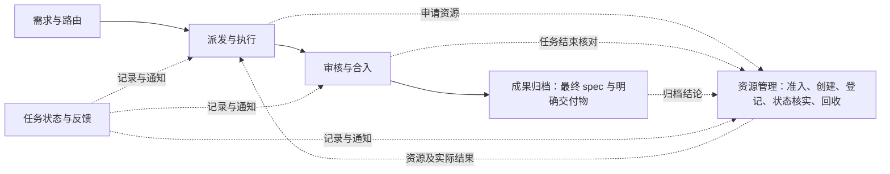
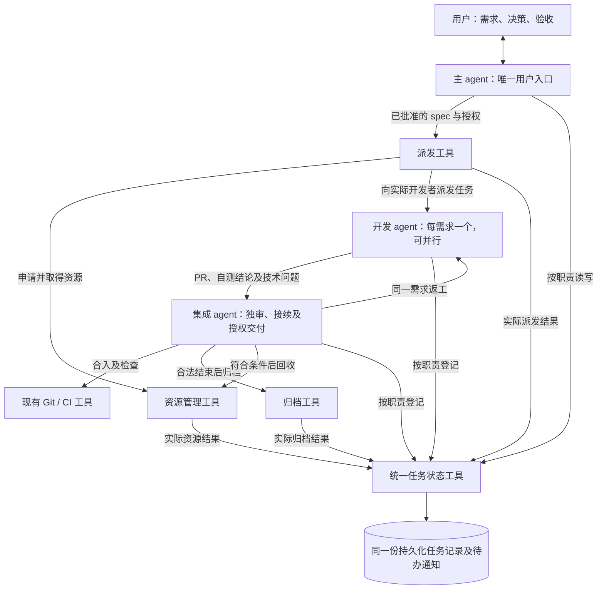

# 插件模块职责与接口设计

STATE-TOOL 实现说明：本 PR 提供职责受限的统一状态、源码绑定、技术交接及独立反馈登记，见[当前接口](../../skills/isolated-parallel-development-coordination/references/task-state.md)。ARCHIVE-TOOL 提供[明确清单原件归档入口](../../skills/isolated-parallel-development-coordination/references/archive-tool.md)，支持 A01—A05 的隔离验证及手动接手；RESOURCE-FLOW 资源创建/关闭准入仍待其独立实现。以下历史设计及验收目标不因此成为实际原生回收或完整闭环通过结论。

讨论记录：2026-11-02。本文随需求讨论更新，区分已确认事项、当前实现和待定设计。当前运行约束仍见[共同规则](../../skills/isolated-parallel-development-coordination/references/current-rules.md)；本次仅更新设计文档。

阅读顺序：本文说明已确认的职责与六步流程；[工具接口与接续设计](tool-interface-contracts.md)说明输入、输出、权限、源码差距和故障恢复；[配套验收清单](../acceptance/tool-workflow-checklist.md)说明后续怎样验证。后两份是本轮技术设计，不是当前实现通过结论。

## 已确认的职责划分

先按以下六个职责梳理插件。它们是职责划分，不表示现有代码已经完成六个独立模块的解耦，也不要求分别建立进程、服务或长期 agent。

| 职责 | 负责什么 | 交付给下一步什么 |
| --- | --- | --- |
| 需求与路由 | 对齐需求、自核 spec、呈现拆分与派发摘要，核对指令归属 | 范围和授权明确的任务 |
| 派发与执行 | 为已批准任务申请资源，向取得资源的开发者派发任务，开发、自测并提交一个 PR | 代码、测试报告和 PR |
| 审核与合入 | 独立审核，原作者返工，对齐最新 main，在授权内串行合入并核证 | 已合入的最终提交和审核结论 |
| 成果归档 | 作为独立工具，由集成 agent 决定调用时机；工具执行并校验最终 spec 和明确交付文件的归档规则 | 归档目录中的最终 spec 及 spec 明确约定的额外交付物 |
| 资源管理 | 提供统一工具接口，负责准入、创建、归属登记、使用状态核实、释放和回收，贯穿任务生命周期 | 各项资源的真实身份、归属、占用及创建或回收结果 |
| 任务状态与反馈 | 提供统一任务状态工具，各 agent 按职责读写同一份持久化任务记录，区分用户待办与无需回复的进度通知 | 同一任务的准确状态、问题及下一责任者 |

主会话是用户唯一入口，开发者按需求建立，集成者负责技术审核及授权交付。代码合入与资源回收分别记录；空闲自动唤醒仍后置。角色流程见[工作流](../workflow.md)。

资源管理不是只在流程末端出现的清理步骤，而是贯穿派发、开发和收尾。派发模块决定何时为哪个任务申请资源，资源管理工具负责执行及登记；集成 agent 根据任务及归档结论调用回收。文件归档未完成时，继续保护相关目录，不阻止符合独立关闭条件的已结束开发 agent 回收。

## 已确认的总体架构：载体与职责映射

用户已确认总体划分：三类 agent 承担判断和调度，工具承担明确操作及规则校验，共用持久化任务记录完成衔接，skill 保存各角色协作规范。六项职责不能直接等同为六个 agent 或六个互相自动调用的工具；下列总体分工已确认，不表示已经实现，也不作为新派工授权。下一步沿一条完整任务逐项细化调用者、工具、输入输出和交接条件。

### 四类载体

| 载体 | 用途 | 本轮定位 |
| --- | --- | --- |
| Agent | 理解需求、判断结果、安排工作及处理例外 | 主 agent、每需求一个开发 agent、现有长期集成 agent 三类角色；不按六项职责各建一个长期 agent |
| 工具 | 执行明确操作、校验规则、返回及登记真实结果 | 派发、资源管理、成果归档、任务状态提供相应接口；代码编辑、测试、Git 和 CI 沿用已有工具 |
| 持久化资料 | 跨调用和会话保留任务事实与明确成果 | 同一份任务记录及其待办/通知，Git 中的代码与 PR/MR，固定归档目录中的最终 spec 和约定交付文件；各自职责清楚，不复制成多套任务状态 |
| Skill | 让不同 agent 遵循同一套职责、授权及工具调用流程 | 保存协作规则和各角色工作指引；不代替 agent 执行判断，也不以指引文字冒充工具已经执行 |

工具是插件提供的功能接口，不预设必须是某种协议或单独常驻服务。底层继续使用真实 Git、文件系统、操作系统与 Codex 宿主能力；资源工具统一管理创建和回收的意图及结果，宿主动作仍只能由当前真正具有该能力的调用者执行。

### 六项职责与实际载体的映射

| 职责 | 判断和调度由谁负责 | 确定性执行及登记由什么承载 |
| --- | --- | --- |
| 需求与路由 | 主 agent 与用户讨论、自核 spec、提出拆合与派工摘要；用户确认；主 agent 判断新指令归属 | 工具记录任务、spec、授权及路由；语义归属无法唯一确定时继续由主 agent 澄清，不让程序猜测 |
| 派发与执行 | 主 agent 按获批任务发起派发；开发 agent 负责实现、自测及一个 PR/MR | 派发工具调用资源管理申请工作树、分支和开发 agent，向实际取得的执行者交付指令；开发使用代码、测试和 Git 工具 |
| 审核与合入 | 集成 agent 独立审核，开发 agent 在原 PR/MR 返工；集成 agent 在授权及确认顺序内串行合入 | 既有 Git/CI 工具执行检查和合入，任务状态工具记录当前测试源码、审核及实际合入结论 |
| 成果归档 | 集成 agent 根据已确认的正常/取消准入决定调用时机 | 独立归档工具按确认清单移动原件、核对并登记结果；工具故障沿既定手动兜底处理 |
| 资源管理 | 派发过程提出初始申请，开发 agent 在授权范围申请临时资源；集成 agent 安排回收或故障接手 | 统一资源管理工具执行准入、创建、登记、观察、释放和回收，关联真实任务及资源身份 |
| 任务状态与反馈 | 各 agent 按职责登记需判断的里程碑；集成 agent 接续技术待办，主 agent 处理用户决策及呈现 | 统一状态工具读写同一份任务记录，汇总待办与通知；其它工具确认的结果自动登记，通知失败另记并接续 |

前三项主要由 agent 运用工具完成，后三项已有明确的独立工具定位；均不意味着可以去掉负责调用、判断及接手的 agent。一个工具的内部确定性步骤可以调用另一个工具，例如派发申请资源、归档成功登记状态；实际执行下一项业务仍须遵守对应角色及授权。

### 角色和工具关系示意

此图显示调用和协作关系，不是强制的时间顺序。图中不增加新的常驻调度 agent，也不承诺通知能够唤醒空闲主会话。

### 一条正常任务的业务流程

1. 用户与主 agent 对齐需求；主 agent 生成并自核 spec，呈现拆合及派工摘要，用户批准后登记任务与授权。
2. 主 agent 调用派发入口；入口经资源管理取得并登记实际工作树、分支及开发 agent，派发同一 spec。未取得资源或结果未知时保留真实状态，不把它报为正在开发。
3. 开发 agent 实现、自测、按授权提交及维护一个 PR/MR，登记开发结果并交集成 agent。一般技术问题由集成与开发者直接接续；确需用户决策的事项进入主会话的决策缓冲池。
4. 集成 agent 审核；不通过交回原开发者。需要用户验收的任务通过主会话组织验收，技术自动验收任务由集成 agent 核验证据。满足实际验收、审核、最新 main、CI 及合入授权后，由集成 agent 串行合入并核对。
5. 任务记录代码已合入完成；集成 agent 调用归档及资源管理工具收尾。文件目录和开发 agent 分别依实际条件回收，不因一个归档待办长期占用已结束开发者的名额。
6. 工具自动登记已核实的实际结果，agent 登记职责内的判断结论；进度通知及需要用户处理的事项按既定通路反馈。重启后从同一任务记录继续，不从零重建状态。

明确取消按前述取消规则走停止开发、spec 归档、放弃代码及专属资源清理，不制造正常合入记录。部署和插件安装继续单独管理，不能由任务完成自动获得授权。

上述载体和职责的总体划分已确认；流程概要中的每一步仍需继续细化接口及跨模块衔接，不把总体认可视为所有细节均已确认。现有工作中的开发任务不因这份设计自动改派或扩大范围。

## 完整任务逐步细化

讨论方式：一次只确认当前一步，统一列出由谁调用、使用何种工具、产出什么及如何交给下一步。下文是设计讨论，不创建真实开发任务或资源。

### 第一步：需求对齐到已批准待派发任务（已确认）

沿用已经确认的需求流程：主 agent 与用户讨论并对齐需求，主 agent 决定拆合、生成 spec 并自核与讨论一致性，再向用户呈现简明的拆合及派工摘要。用户批准摘要即可，不增加逐行审阅 spec 或再次批准同一派工的要求。本例只跟踪其中一份 spec 对应的一项任务。

| 项目 | 已确认的安排 |
| --- | --- |
| 负责者 | 主 agent；此时尚未创建本任务开发 agent，集成 agent 不代替用户确认需求 |
| 输入 | 已对齐的需求、验收要求、约束，以及用户对拆合与派工摘要的真实批准 |
| 工具调用 | 主 agent 使用文件工具生成及核对 spec，随后调用统一任务状态工具登记本任务与已批准的派工安排 |
| 登记内容 | 唯一任务编号、当前 spec、目标和范围、验收方式及标准、约束、原批准及获准的操作、指定集成责任者；未取得的开发者和资源身份保持未分配 |
| 产出 | 一份关联该 spec 及批准的任务记录，状态为已批准、待派发；工具返回可供接续的任务编号及登记结果 |
| 交给下一步 | 主 agent 携带同一任务编号调用派发工具；派发从这份记录读取确认材料，进入下一步资源申请，不重新编写另一套任务或改变原批准范围 |

这一步不创建工作树、分支或开发 agent，不把任务登记成功当成已经开始开发。状态工具检查记录结构、调用者权限及关联，不代替主 agent 判断需求语义，也不因登记任务而授予提交、推送、合入、安装或部署权限。未获用户批准时不能登记为已批准待派发；登记失败时接续同一事项，核实结果后恢复，不因返回失败或未知就重复建立任务。

这一细化方案已由用户确认；当前仅更新设计，没有登记真实新任务，也不创建开发资源。

### 第二步：派发与取得开发资源（已确认）

本步输入是第一步已经批准并登记的同一项任务。主 agent 发起一次派发，不重新要求用户批准已确定的同一安排。派发工具负责把确认材料交给正确的开发者；资源管理工具负责资源的准入、实际创建及归属登记。

| 环节 | 谁调用什么 | 产出及交接 |
| --- | --- | --- |
| 发起派发 | 主 agent 携带任务编号调用派发工具 | 从同一任务记录读取 spec、验收要求、约束、操作授权及集成责任者，核对该任务确实待派发 |
| 申请资源 | 派发工具调用资源管理工具，关联原任务并提供首次任务说明 | 核准入、容量和当前 main 基线；为本任务创建并登记唯一任务分支、工作树及开发 agent 的实际身份 |
| 交付指令 | 派发工具通过资源管理和真实宿主取得开发者并交付首次任务说明 | 开发者获得 spec、范围、验收要求、工作树和分支、实际 main 基线、操作授权及集成交接对象 |
| 登记并返回 | 相关工具按“谁执行，谁登记”更新统一任务记录；派发工具向主 agent 返回结果 | 返回任务编号、实际开发者身份、分支、工作树、基线和真实派发状态；下一步由开发者按同一任务执行 |

资源管理工具负责实际创建，派发工具不另外创建一套工作树或开发者。宿主若在创建开发 agent 时即可传入首次任务说明，则以这一次实际创建及交付完成派发，不强制先造一个空闲 agent 再重复发送指令。具体宿主接线由技术设计负责，不新增常驻派发 agent。

真实资源身份已经取得、指令已经交付，只能说明已派发；进入开发中还需有实际执行观察，不能把资源许可、申请成功或发送接受直接当成正在开发。派发返回后主 agent 不逐步轮询开发；后续开发、自测及技术交接由开发 agent 与指定集成 agent 依职责推进。

资源不足时登记等待资源及原因，仍保留同一任务；创建或交付部分失败时保留已经取得的资源和原操作结果，按已确认规则由集成 agent 核实接续。结果未知先核实，不重复创建、重复派发、换任务号或擅自关闭其它执行者。本轮不讨论自动唤醒，也不在真实环境执行本步。

本步产出是已取得实际专属资源并收到任务的开发者，以及可追溯的同一份任务记录；用户已确认这一分工与交接方式。本轮仅更新设计，不派发真实任务或创建资源。

### 第三步：开发、自测与提交集成审核（已确认）

本步由第二步取得的同一个开发 agent 负责，输入是原任务编号、spec、验收要求、约束、操作授权、实际工作树及分支和指定集成 agent。继续按一需求、一开发者、一工作树、一个 PR/MR 执行。

| 环节 | 谁调用什么 | 产出及交接 |
| --- | --- | --- |
| 开始实现 | 开发 agent 读取原 spec，在专属工作树调用代码与文件工具；通过任务状态工具登记实际开发进展 | 原需求范围内的代码及配套文档，不把新要求或其它任务混入当前范围 |
| 准备并执行自测 | 开发 agent 按需调用资源管理工具申请已授权的临时环境或进程，再调用实际测试工具 | 验收要求对应的真实测试结果及被测源码/提交；测试不足、失败或未测边界如实登记，不把夹具结果冒充真实验证 |
| 提交同一 PR/MR | 开发 agent 在原授权允许时调用 Git 及托管平台工具，提交、推送本任务分支并创建或更新同一 PR/MR | 任务对应的源码提交、main 基线、PR/MR 链接及测试结论；没有提交、推送或提 PR 授权时保持待授权，不因开发完成自行扩大权限 |
| 申请集成审核 | 开发 agent 调用统一任务状态及反馈工具，登记自测完成并向原指定集成 agent 交接 | 任务记录更新为开发自测完成、待集成审核；生成并投递对应集成交接事项，原任务及作者保持不变 |

交接内容至少能让集成 agent 识别：任务编号、原 spec、PR/MR、待审核的实际提交及 main 基线、测试结论和仍需说明的限制或问题。验证结论可保留在任务记录或 PR/MR，不额外要求为交接创建一套长期完整测试报告或日志归档。需要进一步核验的现有测试资料仍供当轮审核使用，长期归档范围继续按已确认规则执行。

状态登记成功、交接发送成功和集成 agent 实际收到分别记录；发送失败或结果未知沿既定通知规则接续，不能把自测完成回退，也不能重复创建 PR 或重新派发开发者。交接入口是给已指定集成 agent 的技术事项，不进入用户决策缓冲池，不等待主 agent 再逐项代发或催审。

开发中一般技术问题由开发 agent 自主解决或与集成 agent 接续；涉及业务定义、新增要求、扩大范围或缺少真实用户授权的问题，经状态及反馈工具提交主会话处理，只等待受影响的动作，其它已授权且不受影响的工作继续。需要用户验收的任务保留该验收待办，开发者不能自记用户验收通过。

开发 agent 完成本步后仍负责原任务的审核返工、最新 main 同步及原 PR/MR 更新，资源继续保留；自测完成或 PR 创建不是任务合法结束点，也不提前关闭开发 agent。用户已确认本步分工及直接交给集成 agent 的方式；本轮只更新设计，不执行开发、提交、推送、发消息或实际状态变更。

### 第四步：集成收件、审核及衔接

本步继续由已经指定的集成 agent 负责，分为收件审核、原作者返工、验收及合入衔接几个小项，逐项确认，不一次授权全部后续动作。

#### 4.1 收件与独立审核（已确认）

| 环节 | 谁调用什么 | 产出及交接 |
| --- | --- | --- |
| 确认收件 | 集成 agent 调用任务状态工具，读取本任务待审核交接并确认接手 | 同一任务由待审核进入审核中，保留原开发者、spec、PR/MR 及本次待审提交；不依赖主 agent 再代发 |
| 核对实际版本 | 集成 agent 调用 Git/托管平台工具，读取实际 PR/MR、源码提交及最新 main | 确认实际待审内容属于原任务，测试对应当前提交；main 已前进则交原作者对齐、回归并更新原 PR/MR，不由集成者代改功能 |
| 进行独立审核 | 集成 agent 使用源码读取、PR 差异、CI 及必要的测试工具，对照原 spec 和验收要求核查 | 判断需求是否实现、范围是否符合、是否有功能缺陷及必要测试缺口；自测结果不足以自行成为独审通过 |
| 登记本次结论 | 集成 agent 调用任务状态及反馈工具 | 记录通过、不通过及具体问题，或尚不能下结论及原因；结论绑定本次实际提交及所核 main，不自动适用于后续改动 |

本项审核输入是第三步交付的原任务、spec、PR/MR、实际源码提交及自测结论。工具负责取数、运行检查和记录；是否符合要求及如何处理问题由集成 agent 判断，不能要求原开发者独审自己，也不额外默认新建审核 agent。

审核使用已经确认的 spec，不临时增加业务要求或把相邻功能改进列为本任务必须完成的条件。按风险和证据缺口进行必要独立核验，不在输入未变且没有新疑点时反复全量重跑。缺失材料、CI/工具故障或结果未知时明确登记尚不能下结论及下一责任者，不将“未核实”冒充通过或功能失败。

本项产出是一份绑定当前源码的审核结论及后续待办：不通过的功能问题交回原开发者，原任务和 PR/MR 保持不变；通过后进入相应的验收或合入条件核对，不能把审核通过等同用户验收通过、获得合入授权或已经合入。具体返工交接及验收、合入衔接在 4.2、4.3 中继续讨论。

用户已确认上述收件与审核分工。集成 agent 负责常规技术接续，真正需要用户决策的事项经主会话处理；本轮仅更新设计，不执行实际收件、代码审核、测试、消息发送或 Git 操作。

#### 4.2 不通过后的原作者返工与复审（已确认）

本项输入是集成 agent 在 4.1 中给出的本次审核结论及具体问题。返工沿用原任务编号、原 spec、原开发 agent、工作树、分支及 PR/MR，集成 agent 不代改功能，不因一次审核不通过新建任务或换开发者。

| 环节 | 谁调用什么 | 产出及交接 |
| --- | --- | --- |
| 发出返工事项 | 集成 agent 调用任务状态及反馈工具，将具体问题交给原开发 agent | 同一任务登记为需返工；交接包含所审提交、问题位置或触发条件、违反的原要求以及需补充的验证；main 落后等技术同步要求单独说明 |
| 接手及修复 | 原开发 agent 通过任务状态工具确认接手，在原工作树调用代码及测试工具 | 登记返工中，修复原需求范围内缺陷；完成对应回归，必要时同步最新 main 并处理冲突 |
| 更新原 PR/MR | 原开发 agent 在已有授权内调用 Git/托管平台工具，更新同一任务分支和原 PR/MR | 新提交及对应测试结论，逐项说明审核问题已修复、仍未解决或需要澄清的情况 |
| 重新交审 | 原开发 agent 调用任务状态及反馈工具，向原指定集成 agent 提交复审 | 同一任务进入待复审；集成 agent 接手后回到 4.1，核对新提交、main 及相关测试，给出新一轮结论 |

返工项应能从具体问题定位到原 spec 或实际缺陷，不能只有笼统的“不符合要求”。不认同的技术结论先由原开发者提供事实，与集成者澄清；确实涉及业务定义、新增要求、扩大范围或缺少用户授权时，经主会话处理，不由任一 agent 静默改写 spec。

同一轮修复可以处理相关问题，不要求为了每条意见分别建 PR 或重走派发。复审检查问题是否解决以及修复的连带影响；已有且仍适用的核验结论可以复用，但不能用旧提交的测试冒充新提交已通过，也不在没有新变化时机械反复执行全部测试。各轮审核及处理结论保留于同一任务记录或 PR/MR，不另扩完整历史报告归档。

反馈发送失败、结果未知或暂未收到，按已确认的通知规则接续，主会话不代为逐项催办。返工期间原开发者及必要工作资源继续保留；任务尚未完成，不提前归档或回收。用户已确认本项返工及复审方式，本轮仅记录设计，不实际发送返工、编辑代码或操作 PR。

#### 4.3 审核通过后的验收与合入（已确认）

本项输入是 4.1 或复审所得的当前源码审核通过结论、原 spec 中约定的验收方式、真实操作授权和当前 PR/MR。审核、验收、合入及任务完成分别记录，不以其中一项代替其它项。

| 环节 | 谁调用什么 | 产出及交接 |
| --- | --- | --- |
| 确认验收安排 | 集成 agent 通过任务状态工具读取原 spec 的验收方式及已完成核验 | 按原约定区分技术自动验收与用户验收，不临时要求用户承担已经约定的技术验收 |
| 完成技术自动验收 | 集成 agent 对照验收标准，使用现有测试及结果读取工具核验证据，复用本轮审核中仍有效的检查，按需补缺 | 登记对应源码及验收范围的技术验收结论；有缺陷则沿 4.2 交原作者返工 |
| 组织用户验收（仅约定需要时） | 开发 agent 准备可用环境、操作及预期；集成 agent 核实后通过状态及反馈工具交主会话，主 agent 按缓冲池顺序向用户呈现 | 用户作出验收决定，由主 agent 记录真实结论；不通过交回原开发者，尚未回复仍保持待验收 |
| 进入待合入 | 集成 agent 调用状态工具，核对所需验收与审核均已通过 | 同一任务及 PR/MR 标为待合入；仍未视为代码已合入或任务完成 |
| 执行合入前核对 | 集成 agent 调用 Git、托管平台及 CI 工具，核当前源提交、最新 main、适用测试及 CI、实际合入授权与确认的顺序 | 仅对已核版本执行授权内串行合入；main 或源码变化先交原作者同步、回归、更新原 PR/MR，再复核；缺授权时通过主会话请求，不默认新增授权 |
| 合入并核实结果 | 集成 agent 调用 Git/托管平台工具合入，检查 main 实际包含交付内容及项目要求的合入后检查，再调用状态工具登记 | 核实成功后记录代码任务完成、最终提交及 PR/MR；另列待归档与待资源回收事项，交后续收尾步骤 |

验收方式在派工时已确定，技术自动验收任务由集成 agent 依据标准作出结论，需要用户体验或业务判断的任务才进入用户验收通路。集成 agent 或开发 agent 不能代记用户已经验收。原有用户验收结论只覆盖实际验收的范围，不能套到后来改变的业务行为；纯技术同步没有改变已验收行为时，集成 agent 以必要回归核对，不机械重复请求全部人工验收。

合入权限沿用当前真实授权：已经明确允许验收后合入的任务，不重复要求用户批准同一动作；只允许提 PR、暂不合入的任务，即使验收通过也继续等待合入授权。部署、打 tag、安装及升级本机不包含在一般合入动作中，仍按各自授权处理。

核对和合入之间发生版本变化时不能沿用失效的核对直接合入。工具结果未知先核实实际 PR 和 main，不盲目重复合并；已经合入但所需检查未通过时如实登记已合入及验证问题，由集成 agent 接续，不误报核实完成，也不擅自撤销 main 或回收原作者。

本项产出是已完成所需验收、授权内合入并核对成功的任务，以及供归档和资源管理消费的最终结果。用户已确认此验收与合入衔接方式；本轮仅更新设计，不执行真实验收、PR 操作、合入、安装、发布或资源回收。

### 第五步：正常交付后的归档及回收交接（已确认）

本步输入是第四步已经合入 main 并核对成功的同一任务及其最终结果。代码任务完成与归档状态分别记录；集成 agent 决定在合法结束后何时调用归档工具，不由合并实现直接移动文件。

| 环节 | 谁调用什么 | 产出及交接 |
| --- | --- | --- |
| 读取待归档任务 | 集成 agent 调用任务状态工具 | 取得任务编号、合入核对结果、最终确认的 spec、原授权及 spec 明确约定的额外交付文件；普通代码任务的额外交付文件默认为空 |
| 发起归档 | 集成 agent 携带原任务编号调用独立归档工具 | 工具从同一任务记录读取确认材料、检查调用权限及正常交付准入，确定本项目固定归档根下的任务子目录，不另搜集历史报告来扩展清单 |
| 执行并核实 | 归档工具使用文件操作能力移动最终 spec 原件及约定的任务专属、未入 Git 交付文件，并核对实际结果 | 文件位于固定任务归档目录，原位置不留副本；记录各文件实际去向及失败或尚待核实的部分，保护其它任务或客户仍使用的文件 |
| 登记结果 | 归档工具调用统一任务状态接口 | 保存本任务归档结果及当前文件定位；承接 spec 的新定位，原位置变更可追溯，不改写既有审核历史来伪造原始文件位置；登记失败保留实际结果待对账 |
| 交接回收 | 集成 agent 根据真实归档结果调用资源管理工具，关联原任务及该结果 | 资源管理取得任务合法结束结论、文件归档结论和仍需保护的文件目录，按下一步规则判断各项资源是否可回收 |

归档结果至少能清楚回答：哪个任务、是否归档完成、文件归到哪里、哪些约定项未完成，以及哪些源目录仍需保留。这里的结果是供下一步使用的真实结论，不是新的宽泛历史材料清单，也不直接授予删除资源的权限。

代码继续保存在 Git 及 PR/MR 中，测试、独审和验收只需在任务记录或 PR/MR 保留最终结论；本工具不重新测试、独审，不默认归档全量日志、完整报告、整个工作树或其它任务材料。归档的具体范围沿用前述已确认规则，不因本步交接新增要求。

归档工具失败时按既定规则由集成 agent 使用可用文件工具手动接手，核实后登记结果。未归档或结果未知的文件目录继续保留；结果未知先核实实际位置，不重复移动。符合独立关闭条件的已结束开发 agent 仍可先交资源管理关闭并在核实后释放名额，不能因归档待办把全部资源回收卡住。

本步产出是可读取的归档文件、同一任务中可查询的归档结果，以及交资源管理处理的回收事项。用户已确认此归档与交接方式；实际资源清理及结果反馈在第六步讨论，本轮仅更新设计，不移动文件、不调用真实归档或资源回收。

### 第六步：逐项资源回收与收尾登记（已确认）

本步由集成 agent 负责调用及故障接手，资源管理工具负责执行和核实。输入为原任务编号、已核实的合法结束结论、第五步归档结果、当前授权，以及从创建起登记的任务资源清单，不在结束时扫描整台电脑猜测资源归属。

| 环节 | 谁调用什么 | 产出及交接 |
| --- | --- | --- |
| 读取收尾事项 | 集成 agent 使用状态及资源管理工具，读取原任务和已登记资源 | 明确实际开发 agent、任务分支与工作树、临时环境或数据库、受管进程等，以及哪些目录仍有待归档文件 |
| 发起逐项回收 | 集成 agent 携带原任务编号及归档结果调用资源管理工具 | 工具核对任务结束、原授权、资源真实身份、是否专属、是否仍有工作或其它使用者及文件保护，逐项判断可回收或应保留 |
| 执行并核实 | 资源管理工具使用可用且获权的 Codex 宿主、Git、进程及文件能力执行对应动作 | 核实开发者实际关闭、专属环境进程停止、工作树和任务分支清理等真实结果；具体顺序按资源依赖安排，不等待全部文件归档才处理符合独立条件的开发者 |
| 登记资源结果 | 资源管理工具调用统一任务状态接口 | 每项登记已回收、保留、失败或待核实及原因，开发 agent 真正关闭核实后才释放对应名额；保留未完成的具体收尾事项 |
| 汇总并反馈 | 集成 agent 读取实际结果，通过状态及反馈工具登记收尾结论 | 需要回收的资源都已核实处理且没有待归档事项时，可记收尾完成；否则保持代码任务已完成、收尾待处理，通知用户实际进度及保留情况 |

原开发者已完成任务、没有待处理开发工作或活动后代且满足关闭条件时，核实关闭其真实身份后释放名额；idle、自报完成、发送关闭请求或收到接受回执均不等于已经关闭。宿主名额与插件许可分别以真实结果核对，不能只改许可记录来冒充实际释放。

工作树及任务专属的本地、云端任务分支按原授权清理，Git 与 PR/MR 中的合入历史继续保留；不删除 main、其它任务分支、固定归档目录或共享资源。归档未完成的文件目录继续保护，资源仍有使用者则保留并说明原因；明确应保留的资源记录原因及后续责任者，不误报为已经删除。

回收按资源分项执行和登记，不要求一个资源失败就恢复或重复所有成功动作。失败或未知时由集成 agent 按已确认兜底规则核实并接续；工具故障可以使用正常工具接手，权限、容量及保护条件不能绕过。对尚有实际动作待办的资源，不能提前记录收尾全部完成，也不因收尾失败撤销代码已完成结论。

状态或通知失败沿既定规则分别留待对账和接续，不重复已经完成的关闭、删除或名额释放。通知实际进度不要求用户再批准已获授权的常规回收；真正超出授权或涉及共享资源处置的决定，才交主会话与用户确认。

本步产出为同一任务下可查询的逐项资源结果、真实名额释放结果、收尾状态及未完成事项；用户已确认本步分工与交接。本轮仅更新设计，不关闭 agent、不释放许可、不停止进程、不删除分支或目录，也不更改运行状态。

### 正常交付链路的确认状态

截至本轮，第一至第六步及 4.1、4.2、4.3 均已逐项确认：需求登记 → 派发及资源取得 → 开发自测及 PR 交付 → 集成审核、返工、验收与合入核对 → 归档 → 逐项资源回收和收尾登记。这里确认的是设计分工与交接，不表示当前插件已经按新设计实现或通过真实闭环验证。

正常链路中的 agent、工具及状态记录职责已对齐。后续技术细化应据此整理各工具的输入输出、调用权限、持久化记录和跨模块调用；不得增加重复的需求审批、业务审核或沿历史材料递归扩展归档检查。任务状态工具记录结果，归档及资源工具分别负责自身实际操作；文件归档保护不能再次成为关闭已结束开发者及释放名额的全局前提。

工具参数、结果格式及恢复细节由主会话负责技术设计，不再要求用户重复确认已定规则；如确需改变业务规则、授权或用户操作方式，再逐项提出。取消及已确认的故障接手规则继续有效，技术核对需覆盖其与正常链路的衔接。实施范围及最终 spec 拆分仍待另行审批，当前不启动开发、提交、推送、合入、安装或发布。

## 当前归档实现

`Runtime.preserve_task` 接受调用方明确选择的本地绝对目录，把需要保留的材料复制到待回收工作树之外，生成 `preservation.json` 清单。任务账本保存该清单的定位信息，后续回收核对它。当前代码还有历史来源恢复、捕获分类和中断恢复检查，详见[资源闭环](../resource/closed-loop.md)和[捕获与必要依赖](../resource/preservation-boundary.md)。

已经推送的代码和 PR/MR 位于 Git 仓库及托管平台。当前本地成果目录还存放测试报告、交接记录、必要的未入库附件等；本地留存不能当作这些附件已同步到云端。插件不要求把整个工作树复制一份。

旧案例中出现过沿报告引用追到其它任务历史测试材料、从而阻塞归档和回收的问题。这个事实说明需要核对依赖范围，不直接证明应该删除整个留存职责，也不证明它必须作为独立模块存在。

## 已确认的归档设计原则

用户要求先明确是否需要归档，再明确保存范围和规则。如果确实需要归档，就由独立模块负责，不并入其它模块。此前主会话建议并入审核与合入，已撤回。

已确认：开发完成后，将最终确认的 spec 原件移动到指定归档目录；不复制一份留作归档，也不只保存链接。正常交付任务在合入 main 并核对成功后才允许归档，具体调用时机由集成 agent 决定。取消任务在用户明确取消、集成 agent 确认停止继续修改后允许归档。此为新设计要求，当前仅记录，不搬动现有材料。移动后的引用承接还需细化。

已确认：测试、独审及要求的验收只保留最终结论，放在任务记录或 PR 中，不要求两处重复保存。完整测试报告、过程日志及完整独审、验收材料不作为首版默认归档项。后续实际出现追溯需求时，再单独讨论完整记录的范围和保存方式，不提前扩展本轮需求。

已确认：额外交付物是需求本身明确要求产出的文件，以 spec 的约定为准。例如制作 Excel 模板任务交付的 `.xlsx`、制作离线安装包任务交付的安装包。普通代码修改默认没有此类额外文件，测试过程中顺带产生的文件不自动成为额外交付物。

不能仅用“必要资料”“可能有用”等模糊表述扩展归档清单。归档依照确认的类别与 spec 明确交付物执行，不通过递归追查日志内部路径增加文件。

## 已确认的归档目录原则

每个项目使用一个固定归档目录，按任务编号分子目录。归档目录位于开发工作树清理范围之外，删除开发工作树不影响已归档的 spec 和交付文件。

路径结构示意为 `<项目固定归档目录>/<任务编号>/`。具体机器路径在实现时通过项目入口确定；该示意不指向现有目录，也不授权现在创建目录或移动文件。

## 已确认的首版范围

范围限定为回收资源后仍可查看最终需求与交付文件；最终交付版本和验证结论可从任务记录或 PR 查询。本轮不承诺完整测试现场或全过程验收材料的恢复。独立模块不要求单独建立服务或长期 agent。

| 类别 | 内容及当前讨论状态 | 保存方式 |
| --- | --- | --- |
| 最终 spec | 已确认归档方式 | 开发完成后移动原件到指定归档目录；不复制，不以链接代替原件 |
| 最终代码 | 正常交付任务已合入的提交、PR/MR、目标 main 的合入记录；取消任务删除专属代码改动及本地、云端任务分支 | 正常交付保存精确定位及核证结果；不复制整个源码树，不额外留存取消代码 |
| 验证结论 | 已确认只保留本任务最终测试、独审及要求的验收结论 | 任务记录或 PR 保留即可；完整报告、过程日志、完整独审及验收材料不纳入默认归档 |
| 额外交付物 | 正常交付任务仅限 spec 明确要求的最终交付文件；取消任务默认放弃任务专属文件 | 正常任务的专属、未入 Git 文件移动原件到任务归档目录，不另留副本；默认空，不自行扩展；取消任务按已确认规则删除，明确要求保留的文件除外 |

自测、独审及验收在各自阶段的核验责任继续保留。归档范围收窄不等于取消合并前的验证，也不要求立即删除已有报告、失败证据或旧成果目录。当前仅更新设计，既有运行检查尚未修改。

临时缓存、临时数据库、生成中间文件、整套开发环境、全量 agent 对话及其它任务材料，不因开发或验证过程使用过就自动加入首版归档清单。

提议的范围识别规则：以本任务交付清单为准；报告或日志内部出现的文件路径不自动扩充清单；其它任务按任务号、提交等定位，不复制其整条历史材料链。归档结束后，资源回收消费归档结论，并继续核对当前资源归属、授权及使用情况。

## 归档与资源管理接口：已确认规则及待定事项

上述已确认范围及目录原则作为后续设计依据。归档的范围、目录原则、触发分工、正常与取消准入、取消收尾及失败兜底已对齐。以下案例是据此整理的验收草案，不代表实现已经通过；当前不改变现有归档或回收检查。移动后的引用承接、重复调用、中断核实及手动操作结果登记等技术细节由主会话后续整理设计，不为每个实现细节重复要求用户决策。

### 已确认的触发方式

已确认：归档做成独立工具，由集成 agent 决定实际调用时机；工具负责执行和校验归档规则。归档不直接写入合并实现作为自动触发动作。

此前比较的两种方式如下，用户已选择第一种。两者都需要代码实现归档，区别在于谁调度调用。

| 方式 | 收益 | 需要解决的问题 |
| --- | --- | --- |
| 指定 agent 调用独立工具 | agent 可以安排交付节奏、处理例外；归档模块的接口小、职责集中 | agent 可能漏调用；任务状态模块应持续列出待归档项 |
| 代码流程自动调用归档模块 | 固定步骤可以自动衔接，减少依赖 agent 记得调用 | 需要分别保存合入与归档的结果，避免归档失败被误报为合并失败；流程变化需调整编排代码 |

职责分工：集成 agent 在授权内调度；允许归档的条件、固定目录、确认的文件清单、原件移动及结果核对由工具代码执行。agent 选择何时调用，不获得扩大清单、修改前置条件、覆盖另一任务归档的权限。正常交付和明确取消的归档准入均已确认。

任务状态与反馈模块记录待归档、已归档或归档失败；已合入但未归档的任务不能显示全部收尾完成。集成 agent 在既有工作周期处理待归档项，不要求用户逐项催促或再次批准常规调用。这一方案不包含后台轮询或空闲自动唤醒，也不把提示已生成当作动作已执行。

代码自动调度同样可以调用独立归档模块；无需把移动文件直接写进合并实现。此为方案比较，不新增自动编排、服务或配置能力。

### 已确认的正常交付准入

已确认：对正常交付的开发任务，工具仅在 PR/MR 已合入 main 并核对成功后允许执行归档；开发、自测、审核及返工阶段拒绝移动最终 spec。满足这一条件后，集成 agent 自行选择实际调用时机，不由合并代码自动触发文件移动。

### 已确认的取消任务归档准入

此前已确认明确取消也是合法结束依据，先保留约定归档材料再关闭对应 PR/MR、回收资源；取消不等于正常完成，不能为结束而制造合入记录。来源见[开发者生命周期设计](development-agent-lifecycle-spec.md)。本轮用户进一步要求收窄取消代码的处理方式，不能再以旧的宽泛“保留成果”表述默认保存所有未完成代码。

已确认：用户明确取消该任务、集成 agent 确认停止继续修改后，允许调用取消归档入口；不要求合入 main，也不要求为了归档继续完成开发、自测或验收。将取消时最后确认的 spec 原件移动到该任务的归档目录，在任务记录中标明已取消及取消依据，不改写 spec 原文来伪装正常完成；有用户给出的原因则记录原因，不强制补填。

取消代码和额外交付文件的处理范围均已确认。本轮不据此提交、删除、移动任何现有成果，也不提前关闭开发 agent。

### 已确认的取消任务代码处理

用户要求先确定取消后代码怎样处理，再讨论由谁处理。已确认：任务取消，意味着放弃该任务的代码改动，应删除这些改动。此前主会话建议保存“取消时留存”提交并推送、长期保留原任务分支，已撤回，不纳入开发要求。

已确认具体范围：针对尚未合入 main 的取消任务，丢弃本任务未提交的代码改动，清理该任务专属工作树、本地任务分支以及已推送的云端任务分支；存在 PR/MR 则关闭，不合入 main。main、其它任务分支和其它使用者的资源不受影响，不为取消代码额外提交、推送、打包或建立备份分支。

删除任务分支不等于从 Git 托管平台抹除全部历史提交和 PR/MR 记录；不把历史记录仍可查误认为取消代码仍在参与开发。已经合入 main 的代码不适用这一未完成任务取消方案，若需撤销另行处理。

最终 spec 仍按已确认的取消归档规则移动原件，代码清理不能连带删掉需归档的 spec。本节记录设计决定，不执行任何真实丢弃、删除、分支清理、提交或推送。

### 已确认的取消收尾分工

已确认：主会话记录用户明确取消的决定及任务归属；开发 agent 停止继续开发和写入；现有集成 agent 统一负责取消收尾，在授权内调用对应工具完成 spec 归档、PR/MR 关闭、任务分支和专属资源清理，并核对各项实际结果。归档工具负责归档，Git 操作及资源删除由对应工具执行，不混入归档实现。

这一分工属于已确认的设计，不将本次讨论直接转成清理动作。具体操作顺序、失败接续和受限宿主工具接线还需继续细化；记录取消不代表实际开发已停止，发出清理调用也不代表资源已回收。

### 已确认的取消任务额外交付文件处理

已确认：取消任务的额外交付文件同样视为放弃。已经产生、属于该任务专属且没有其它使用者的文件默认删除，不移入归档；尚未产生的文件不要求补做，缺少这些未产出文件不阻塞取消归档。取消任务默认只归档最后确认的 spec，在任务记录或 PR 保留取消结论。

若用户取消时明确要求保留某个文件，按该具体指令处理，不自行推断例外或扩展清单。本节记录已确认设计，不删除现有文件，不影响共享文件、其它任务成果或已交付到其它位置的客户文件。

### 已确认的归档失败处理与手动兜底

已确认：归档工具执行失败后，回退到集成 agent 手动归档，不能持续等待故障工具恢复而卡住任务。手动归档由集成 agent 使用正常可用的文件操作方式完成，不转交用户操作，也不要求先通过故障归档工具派发其修复任务。

手动归档沿用相同的任务准入、固定归档目录、确认文件清单和 spec 原件移动规则，不能扩大范围或伪造成功。因任务未结束、归属或权限不符而拒绝执行，不属于允许手动绕过规则的执行故障。结果未知时先核实文件实际位置，再接续未完成动作，不重复移动或覆盖已有归档。

归档失败不撤销代码完成或已取消的结论，单独记录失败及手动处理结果。尚未归档的 spec、需保留交付物及相关源/目标目录不删除；手动归档完成后核对实际文件，并登记最终位置与结果。状态登记暂不可用时保留真实操作记录待对账，不重做已完成的文件移动，不直接篡改账本制造成功。

已确认：对已合入 main 并核对成功或已明确取消、且已确认停止开发的任务，允许先关闭已经结束工作、符合独立关闭条件的开发 agent，在实际关闭核证成功后释放对应名额。归档未完成的文件目录继续保留待处理，其它任务可以继续；手动归档也暂时无法完成时，继续保留文件和明确待办，不以该归档待办长期占用已结束开发 agent 的名额。

归档失败只阻止会丢失待归档文件的目录清理，不把全部资源回收绑定在归档工具成功上。正在开发、尚未确认停止、仍有活动后代或其它使用者的资源不因此提前回收。这些是新设计决定，当前实现尚未调整，本轮不执行实际归档、关闭或许可释放。

### 已确认的正常任务额外交付文件迁移方式

已确认：对正常交付任务 spec 明确约定、未保存在 Git 中、且属于该任务专属的额外交付文件，与最终 spec 一样移动原件到同一任务归档子目录，原位置不另留一份。其它任务或客户仍使用的文件不能按专属文件直接移动。本轮仅记录规则，不改变现有交付文件位置。

### 已确认的资源管理定位及回收工具原则

已确认：资源回收以独立工具提供，由集成 agent 决定调用时机。按该任务登记的专属开发 agent、工作树、任务分支及临时环境执行清理，逐项返回已回收、保留、失败或结果待核实。工具核验当前授权、资源身份、共享或保护关系及实际结果；消费任务状态及归档模块的结论，不沿历史报告重新扩展成果依赖。归档未完成时对文件目录的保护及已结束开发 agent 名额的独立回收，沿用上述已确认规则。

已确认：第五项职责为资源管理，覆盖资源从创建到回收，而非只在结束时清理；仍保持六个模块。下文区分现有创建实现与已确认的新职责，上方职责表及架构图已同步，运行实现尚未调整。

#### 当前资源创建由谁负责

主会话调用标准派发入口。`StandardDispatch.run` 经 `ResourceBridge.admit` 向资源控制器申请执行名额，使用 `GitWorktrees.create` 创建任务工作树和分支，再经 `Runtime.launch`、宿主适配调用实际 Codex 原生工具创建开发 agent，并登记真实身份。资源准入许可与 Codex 原生容量是两件事，许可通过不保证宿主创建一定成功。

临时环境目录、临时数据库文件及受管进程另有 `ResourceBridge.create_temporary`、`run_process` 入口，由具备该任务资源权限的调用者使用。`ResourceBridge.create_worktree` 也提供工作树创建路径，但标准派发当前直接调用 Git 适配并分别登记。因此已有创建和管理能力，尚不是所有创建与回收都经过一个集中管理接口；不能声称目前资源完全没有登记。

核对位置：`src/codex_parallel_coordination/dispatch.py`、`bridge.py`、`worktrees.py`，以及 skill 的 `scripts/core_runtime.py`、`host_adapter.py`。这是当前源码的静态核对，不代表本轮已实测新的资源管理闭环。

#### 已确认的资源管理职责

已确认：派发与执行模块决定何时为已获批任务申请哪些资源；资源管理模块提供统一工具接口，负责准入、创建、登记、状态核实、释放与回收。归档仍是独立模块，任务完成与否仍由任务状态及交付核对给出。任务状态与反馈模块消费资源管理的真实结果，不另行推断资源已创建或已回收。

| 阶段 | 决策及调用者 | 资源管理工具负责 |
| --- | --- | --- |
| 开始任务 | 用户批准范围、主会话完成派发安排后，派发模块提出资源申请 | 核权限及容量，创建并登记任务分支、工作树和实际开发 agent；部分失败保留已创建资源及原申请状态 |
| 开发、自测 | 开发 agent 提出本任务确有需要的临时环境或进程请求；在已授权范围内直接调用，超范围交集成 agent 核实 | 按任务登记专属资源、核资源占用与冲突；不通过新增未登记资源绕过准入 |
| 完成或取消 | 集成 agent 根据真实任务及归档结论调用收尾 | 逐项关闭或删除符合条件的专属资源，核实实际效果后归还名额；受保护、共享或仍使用的资源保留 |

底层继续使用 Git、操作系统及 Codex 真实能力，统一管理不等于插件能修改宿主自身容量。创建失败或结果未知不能直接当成“没有创建”重试；已成功创建的资源继续归属原任务，恢复时核实后复用，避免重复 agent 或无归属工作树。具体接口与故障接续由后续技术设计细化，不在本轮实现。

#### 已确认：资源管理工具执行故障的兜底

已确认：资源管理工具自身执行故障时，由集成 agent 组织使用正常可用的 Git、文件及宿主工具接手同一任务的资源创建或回收，不以先修复插件为前提。继续遵守原任务授权、实际资源归属、共享保护及归档文件保护；容量不足、权限不足或仍有使用者不属于可以绕过的工具故障。

已成功创建或回收的资源不重复操作，结果未知先观察；实际动作由具备相应能力的调用者执行，不假设集成 agent 具备主会话专属的原生工具。接手后核对实际效果并登记，登记暂不可用则保留实际操作记录待对账，不直接篡改账本制造成功。此为已确认设计，不授权本轮实际创建或清理资源。

### 已确认的任务状态工具及角色分工

此前已确认代码任务合入 main 并核对成功后为完成，部署单独管理；归档及资源收尾另记结果，不能因某项收尾尚未完成就将代码完成退回开发中。需要用户回复的事项进入缓冲池，无需回复的真实进度及资源回收通知沿独立反馈通路展示。这些既有决定继续有效，不重新要求用户确认；本轮仍不开发空闲自动唤醒。

已确认：本模块的核心是统一记录各任务的状态，包括当前阶段、是否受阻及原因、下一责任者、是否需要用户决策或验收，以及归档和资源回收结果。以统一任务状态工具提供读写入口，所有调用者按职责使用同一份持久化任务记录，不各自维护另一份任务状态，也不依赖某个 agent 的对话记忆维持进度。

| 调用者 | 已确认的用途 |
| --- | --- |
| 开发 agent | 登记本任务开发进展、自测结果、遇到的问题及审核申请 |
| 集成 agent | 登记审核、合并、归档及资源回收的真实结果 |
| 主会话 | 查询各任务进度和待办，承接并登记用户的决策及验收结论 |

工具限制角色及任务范围：开发 agent 可以登记开发完成、申请审核，不能替集成 agent 登记审核通过；调用者不能通过写状态自行扩大授权。主会话依据同一份记录安排任务接续并向用户同步，避免开发已完成却无人接手。

各模块继续负责自身业务及真实结果。状态工具负责结果归属、角色权限及状态衔接的核对，不重新执行审核、归档、资源创建或回收，不沿历史报告扩展检查。具体事件、重复或过期反馈处理及状态结构由技术设计细化；本轮不实现该统一工具。

#### 已确认：状态更新由谁触发

已确认采用“谁执行，谁负责登记”：工具能够核实的结果，由执行该动作的工具调用统一状态接口自动登记；其它进展及需要判断的里程碑，由负责的 agent 调用任务状态工具登记。例：归档工具移动并核实成功后登记归档完成；资源管理工具核实 agent 关闭及名额释放后登记对应结果；开发 agent 完成自测后登记结果并提出审核申请。主会话无需逐项收集这些事实再代为补写。

这里的自动登记仅更新同一份任务记录，不自动授权或执行下一项审核、合并、归档、回收及部署。手动接手由集成 agent 核实实际结果后登记；登记失败保留真实结果待对账，不撤销或重做已成功的操作，不直接改写底层文件伪造状态。此为已确认设计，具体状态接口由后续技术设计落实，本轮不改代码。

#### 已确认：通知失败与任务执行分开处理

此前已确认需要用户回复的事项进入决策缓冲池，无需回复的进度及资源回收情况直接向主会话反馈。状态已登记、通知已发出和已在主会话展示是不同事实；本轮不把这些事实合并为一个完成标记，也不重新讨论空闲自动唤醒。

已确认：通知失败单独记录并接续处理，不把已经核实的开发、合入、归档或资源回收结果退回，也不阻塞其它已授权工作的推进。例如归档已完成但消息未送达主会话，应保留已归档事实及该条未送达通知，不能为补通知重新移动 spec。

由集成 agent 在后续实际工作周期核对并处理未完成通知，主会话在实际收到后向用户展示；查询任务时仍能查看真实进度及尚未通知的事项。发送结果未知时先核实，不无限重发；已经确认展示的同一事项不重复通知。涉及用户决策的原动作仍须等待决定，不能以通知失败为由跳过审批。本节为已确认设计，不新增轮询、后台常驻或自动唤醒。

## 实施范围提议（待拆合与派工审批）

归档、资源管理、任务状态、通知处理和三类 agent 的六步正常流程已逐项确认；本轮已补[工具接口设计](tool-interface-contracts.md)及[验收清单](../acceptance/tool-workflow-checklist.md)，涵盖取消和故障接续。具体实施范围、拆为几份 spec 和派工安排仍待摘要审批，不因技术文档完成直接启动开发。

随后已形成STATE-TOOL、ARCHIVE-TOOL、RESOURCE-FLOW三份spec草案及主会话自核；[接口设计中的拆分表](tool-interface-contracts.md)说明范围、依赖及34项验收归属。用户尚未审批本次拆合与派工摘要，未创建任何对应运行任务、开发agent或工作树。

建议首轮围绕一条真实开发任务闭环落地：任务登记与派发申请 → 受管资源创建与使用 → 审核及合入核对 → 最终 spec 与约定交付文件归档 → 专属资源回收 → 同一份任务状态更新及进度反馈。优先调整已经确认变更较大的归档、资源管理和任务状态工具；需求路由、派发及审核合入保留已经确认的流程，只做完成本闭环所需的接口对接。正常合入及明确取消两条路径均需验证。

先证明真实任务能从开始走到完成及收尾，再讨论其它模块新增能力；空闲自动唤醒继续后置，不因本轮设计扩大已有任务范围。该落地范围与顺序尚待用户确认，具体拆为几份 spec 由主会话在技术设计后提出摘要供用户审批。当前不派发开发，不提交、推送、安装、删除资源或更改运行状态。

## 验收草案（尚未实现）

1. 最终 spec 原件已移动到指定归档目录，原位置不再保留另一份；归档内容一致、后续查询正常，其它已约定归档项完整：即使旧测试临时文件已删除，也可进入回收。
2. 正常交付任务的 spec 明确列出的额外交付文件缺失：预期指出具体缺项，不能声称成果已经完整保存。取消任务不要求补齐已放弃的文件。
3. 成果已留存，但资源仍有其它使用者：预期保留资源，不误删。
4. 本任务记录或日志包含其它任务的旧路径：预期只核对确认的归档清单，不因此扩展本任务归档范围。
5. 最终验证结论已保存于任务记录或 PR，完整过程日志没有长期留存：预期不因缺少非默认归档材料而阻塞归档和回收。
6. 归档目录位于开发工作树清理范围之外：预期删除工作树后，仍能在该任务的固定归档子目录读取最终 spec 和约定的交付文件。
7. 集成 agent 提前调用或调用未获授权的任务时：预期按确认的阶段及权限规则拒绝，文件不变；合法调用后的重复调用返回原归档结果，不重复移动。
8. 合入成功但归档尚未调用或归档失败：预期分别显示代码已合入与归档待办/失败，不误报整体结束，也不把合入成功改成失败。
9. 明确取消且已停止修改的任务没有合入 main：预期可以走取消归档，保持已取消状态，不制造合并、测试通过或验收通过记录；没有取消依据的进行中任务不能借此提前归档。
10. 取消任务的专属工作树及本地、云端任务分支清理后，main 和其它任务不受影响，不产生“取消时留存”提交或代码备份；已归档的 spec 仍可读取。托管平台既有历史记录不作为清理失败依据。
11. 任务曾约定交付 Excel 模板但被取消：只保留约定的 spec 与取消结论，已生成的任务专属模板按规则删除，未生成的模板不要求补做，也不因交付清单尚未完成而卡住取消归档。
12. 已合法结束的任务因目录权限导致 spec 未能归档：预期保留 spec 所在目录并转交集成 agent 手动归档；满足独立关闭条件的开发 agent 可以先关闭，经真实核证后释放名额，新的任务不因这个归档待办继续占用旧名额而受阻。
13. 归档工具自身故障，但普通文件操作可用：预期集成 agent 不等待该工具修复，按同一清单手动移动并核对结果，记录实际归档位置后接续目录清理；不要求用户代操作，不重新移动已经完成归档的文件。
14. 正常交付任务含 spec 明确要求、未存入 Git 的专属 Excel 模板或安装包：预期移动原件到任务归档子目录，原位置不留副本；其它任务正在使用的文件不被误移。
15. 新任务创建分支、工作树及开发 agent：预期经统一资源管理接口准入并登记真实身份及任务归属；开发时新增的受管临时环境或进程继续关联同一任务，收尾从同一资源清单核对，不在结束时重新猜测归属。
16. 工作树已创建但开发 agent 创建失败或返回未知：预期保留已创建资源、原申请及真实结果，核实后接续原任务，不重复创建工作树或未知状态的开发 agent，不将插件准入许可当作宿主名额保证。
17. 资源管理工具自身故障而正常 Git、文件或宿主工具可用：预期集成 agent 在原授权及保护范围内组织接手、核实并登记实际结果，不以先修好插件为前提；已成功的动作不重复，未知结果先观察，容量或权限拒绝不能被手动绕过。
18. 开发 agent 登记开发完成及申请审核：预期只更新其负责的任务，不产生审核通过、已合入或资源已回收记录；越权登记被拒绝。
19. 主会话、开发 agent 和集成 agent 从统一状态工具查询同一任务：预期读到同一份持久化记录；重启会话后仍能识别当前阶段、受阻原因和下一责任者，不以各自聊天记录生成另一套任务状态。
20. 工具已经核实归档或资源回收的实际结果：预期在执行该动作时调用统一状态接口自动登记；开发 agent 的自测里程碑由本人登记。主会话无需代写各项状态，自动登记不授权或执行下一步业务动作。
21. 实际操作已经核实成功、任务状态已更新，但进度通知发送失败或结果未知：预期分别保留操作结果和通知待办，核实后接续通知，不回退状态、不重做操作；其它已授权工作继续，需要用户决策的动作仍等待确认。

上述是早期业务验收草案；后续开发以[配套接口与闭环验收清单](../acceptance/tool-workflow-checklist.md)逐项核对实现结果，不把清单写完当作测试已通过。尚未授权按本文改代码、调整实际归档目录、删除材料、安装或发布。
