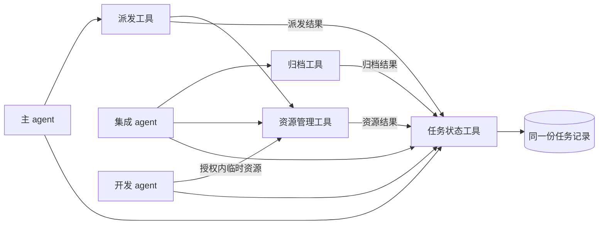

# 工具接口与任务接续设计

STATE-TOOL 已提供职责受限的统一状态、源码绑定、技术交接及独立反馈登记，见[当前接口](../../skills/isolated-parallel-development-coordination/references/task-state.md)。

RESOURCE-FLOW 候选提供统一创建、独立作者关闭/许可及取消接续，见[资源入口与当前边界](../resource/resource-flow.md)。文件回收与 ARCHIVE-TOOL 的真实接入及 34 项联测仍待其实际合 main 后完成；契约夹具不代表整体验证通过。

日期：2026-11-02。业务依据：[已逐项确认的架构及六步流程](plugin-module-architecture.md)。本地源码核对基线为 `4097bd8bb9deed4ab96bdf216b5a8a84ee75e627`；这是本次读取的本地提交，不是对当前云端或本机安装版本的核验。

本文是技术设计，接口动作名用于说明契约，不表示现在已经有这些新工具。未修改运行代码、任务账本、安装配置或资源；开发拆合与派发仍需另行审批。验收要求见[接口与闭环验收清单](../acceptance/tool-workflow-checklist.md)。

## 1. 工具层的组成

保留三类 agent，不按六项职责另建六个执行者。主 agent 处理需求及用户事项，开发 agent 实现一项需求，集成 agent 负责独审、授权交付和收尾。Skill 规定各角色怎样调用工具。

| 工具 | 调用者 | 负责的确定性操作 | 交给调用者的结果 |
| --- | --- | --- | --- |
| 任务状态工具 | 各 agent 按角色；其它工具按内部能力登记 | 同一份任务记录、角色约束、阶段衔接、待办及通知记录 | 当前进度、下一责任者、需要处理的事项 |
| 派发工具 | 主 agent 发起；获权集成者核实及接续 | 读取已批准任务，申请资源，交付任务说明 | 实际开发者、工作位置及真实派发结果 |
| 资源管理工具 | 派发过程、已授权开发者及集成者 | 准入、创建、登记、观察、停止或回收、释放许可 | 每项资源的真实身份、结果及仍需处理的事项 |
| 归档工具 | 集成 agent | 按任务准入及约定清单移动原件，核实去向 | 归档位置、完成项及待保护目录 |

代码编辑、测试、Git、CI、文件及 Codex 原生工具继续使用已有能力，不为每项既有操作再包一层新工具。

状态工具不反向调用归档、资源或 Git 去重新核验业务；各生产工具负责自身事实。归档不依赖资源回收成功，关闭已结束开发者也不依赖所有文件归档成功。外部操作由实际宿主执行，能力不足如实返回，不借工具接口冒充具有原生权限。

## 2. 共用的调用约定

所有入口绑定同一受信项目上下文，包括项目根、已有状态根、角色及真实调用者、已授权工具能力、归档根和受管资源根。这些信息由实际宿主提供，不从任务消息或报告中读取一个自称管理员的字段。

项目身份由固定项目入口绑定，开发工作树单独作为资源登记。开发者切换到自己的工作树后，不能用当前目录重新派生另一项目账本；真实调用者使用当前宿主提供的线程身份，不用任务文件或父会话身份替代。

| 调用信息 | 约定 |
| --- | --- |
| 任务编号 | 创建任务后始终复用；不同模块不重新命名同一任务 |
| 操作编号 | 有副作用的调用必须稳定标识一次逻辑操作；重复读取原结果，不盲目重做 |
| 目标版本 | 审核、自测、验收及合入结果关联实际提交和 main 基线；资源动作关联实际资源身份 |
| 输入修订 | 改写记录时核对所依据的当前修订；过期写入不能覆盖别人刚登记的结果 |
| 用户依据 | 需求批准、授权、取消及用户验收来自真实用户决定；引用文件只定位依据，不自行赋权 |
| 测试范围 | 实际宿主结果与夹具结果明确区分；夹具通过不升级成真实关闭或云端合入 |

对状态更新使用明确业务事件，不提供任意设置阶段、审核通过或已回收的通用写入能力。工具验证身份、事件来源、任务归属及必要前置事实，不再递归读取历史报告。

## 3. 任务状态工具

### 输入、输出及动作

| 动作 | 主要输入 | 输出与限制 |
| --- | --- | --- |
| 登记任务 | spec 原件及其当前版本、目标与验收、真实批准、原授权、指定集成者 | 唯一任务编号及已批准待派发记录；实际开发者、分支及工作树未取得时不伪填 |
| 查询任务 | 任务编号或当前角色负责范围 | 同一修订的任务摘要或详情；只读，不生成新任务或刷新不存在的事实 |
| 登记业务结果 | 任务编号、稳定事件编号、对应版本、职责内结论及实际结果定位 | 更新有权修改的字段、产生相应待办；不能借登记扩大权限 |
| 获取待办 | 角色、任务范围及读取位置 | 技术交接、用户待办、进度通知分开返回，不另建第二份任务队列 |
| 接续反馈 | 原事项、实际发送或接收结果；主会话实际展示情况 | 分别记录待投递、投递结果未知或失败、已接收、已展示；接受发送不等于用户已看到 |

“谁执行，谁登记”既适用于工具自动登记，也适用于 agent 登记需要判断的里程碑。归档、资源等工具仅能通过自己的固定能力写入其已核实的操作结果，不能提交任意字符串冒充另一个模块。

查询结果同时标明最后登记及实际观察的时间和版本；没有新观察时明确是最后已知事实，不把读取一次记录表述为刚核实了当前宿主状态。

### 写入权限

| 写入者 | 可登记 | 不可代记 |
| --- | --- | --- |
| 主 agent | 已对齐任务、真实授权/取消/用户验收、事项呈现 | 未观察的开发、归档或资源结果 |
| 原开发 agent | 本任务进展、问题、自测及原 PR 交付、返工回应 | 独审通过、用户验收、已合入、已归档或已回收 |
| 指定集成 agent | 收件、独审、技术验收、实际合入核对及收尾；手动接手后的已核实结果 | 用户尚未作出的决定或其它任务的状态 |
| 生产工具 | 本次实际派发、归档、资源操作的结果 | 超出其能力和原授权的业务结论 |

手动接手登记仍需有对应实际操作及核实结果，不能只传“成功”。工具产生结果的可信来源及 agent 的实际角色由宿主固定；不新增自签文件、额外账号或密钥体系。

## 4. 一份记录，多项独立事实

复用项目唯一 `ledger.json`。任务阶段、归档、资源和通知分开存，但通过同一任务编号关联，不能由一个笼统的完成字段互相代替。

| 记录内容 | 最小必要信息 |
| --- | --- |
| 需求及授权 | spec 当前定位及内容身份、范围、验收方式和标准、用户依据、获准操作、各角色归属 |
| 开发及交付 | 实际作者、工作树、任务分支、源提交、PR/MR、自测、独审及验收结论 |
| 任务阶段 | 已批准待派发、等待资源、已派发、开发中、待审核/审核中、需返工、待验收、待合入、已完成或已取消；附真实执行观察和下一责任者 |
| 归档 | 未开始、进行中、完成、部分、失败或待核实；确认清单、文件实际位置及应保留目录 |
| 每项资源 | 类型、实际身份、所属任务、共享引用、保护及使用情况、创建/回收操作、真实关闭和许可释放结果 |
| 待办及通知 | 事项类型、接收者、关联任务和版本、处理结果、发送与展示情况；用户决策缓冲池只含需用户回复的事项 |
| 操作记录 | 原输入身份、操作意图、已发生的结果及最小恢复信息；不以此增加完整测试报告或历史材料的归档义务 |

已有 RESOURCE 存储可继续保存容量、进程及资源的底层事实，不能另存一份任务阶段或用户决策队列。统一记录读取这些结果的关联，不反向猜测模型容量、原生名额或物理内存已经释放。

新入口的任务写入共用同一存储及修订控制，不允许各模块直接改写 JSON 绕过角色和状态检查。新任务使用明确的接口契约绑定；旧记录缺少新字段时不能补造已创建、已停止或已回收事实，也不初始化另一套账本来绕过旧记录。

自测及审核通过只对所核版本有效。main 前进交原作者更新原 PR、回归及复审；纯技术同步没有改变已验收行为时，集成者核对必要回归，不机械重复全部人工验收。

没有配置 CI 的项目如实记为未配置，按已确认的验收条件处理，不制造 CI 通过；原要求明确必须具备的检查缺失时继续留待处理。

## 5. 派发工具

| 动作 | 输入 | 负责执行 | 返回 |
| --- | --- | --- | --- |
| 开始派发 | 已批准任务编号、原操作编号 | 读取同一记录，准备任务说明，调用资源管理准入和创建，再通过实际宿主交付任务 | 真实 agent 身份、工作树、分支、main 基线及已交付/等待/未知结果 |
| 核实及接续 | 原任务、原操作、当前实际观察 | 查询原创建或交付效果；对确认尚未完成的步骤在原授权内显式接续 | 原请求的新观察及下一步，不换任务或重复创建 |

资源的实际创建及登记集中在资源管理入口；派发不再直接另造工作树。宿主支持创建时附带任务说明则一次完成，避免创建空 agent 再重复发送。派发工具返回后，开发与技术交接由开发者和集成者推进，不让主 agent 逐步轮询。

插件准入许可不保证 Codex 仍有原生名额。返回中分别说明许可状态、实际 agent 是否取得、任务是否已交付、是否已观察到执行；缺少其中事实就保留未知，不补造身份。

## 6. 资源管理工具

| 动作 | 输入 | 产出 |
| --- | --- | --- |
| 申请开发资源 | 原任务及操作编号；派发提供的首次任务说明 | 准入结果，当前 main 对应的专属任务分支、工作树及实际开发者；未创建项保留空值 |
| 申请临时资源 | 本任务、用途、已授权类型和必要规格 | 已登记的专属环境/临时库/文件/进程及真实身份，或具体等待/拒绝原因 |
| 观察资源 | 原任务、资源或操作编号 | 只读实际身份、运行或退出情况、使用关系，不触发重复创建或清理 |
| 回收资源 | 合法结束任务、原回收操作及指定的已登记资源；关联归档结果 | 每项已回收/保留/失败/待核实、原因和下一责任者；关闭核实后另核许可释放 |

工具按已有资源记录回收，不扫描整台机器。不把共享 Codex、主/集成 agent、客户数据、其它工作树或固定归档目录列为本任务专属资源。

回收检查拆为两类：

- **开发 agent 关闭**：任务合法结束、作者停止工作、无活动后代或待办、真实身份及授权相符。即使某个文件仍待归档，也可独立执行。实际关闭核实后才释放对应许可。
- **文件及环境清理**：除归属、授权及使用情况外，核对涉及目录中的约定归档文件已安全移出；有其它使用者、待归档文件或身份变化则保留具体资源。结束专属服务后再处理其占用文件。

各项结果独立登记，失败不撤销成功项，也不撤销代码完成结论。临时进程已退出不等于整个任务结束，agent 自报完成或 idle 不等于实际关闭，删除目录也不证明名额已释放。

若原任务已取得插件许可，但真实宿主明确证明从未创建开发者，允许按原身份核实未使用许可并释放；这不记录为关闭了一个不存在的 agent，也不代表回收了真实原生名额。创建结果未知时不能套用此分支。

## 7. 归档工具

| 动作 | 输入 | 负责执行 | 返回 |
| --- | --- | --- | --- |
| 执行归档 | 合法结束任务及原操作编号；模式从任务实际结束类型读取 | 从同一记录取得最终 spec 和约定交付清单，移动原件并核对内容，自动登记结果及新定位 | 各项归档位置、完成情况、未完成项及应保留源目录 |
| 核实归档 | 原任务、原操作及实际位置 | 观察已发生的移动，对部分或未知结果核实；不重复移动或覆盖 | 真实归档结果及可接续步骤 |

正常任务仅移动最终 spec 及 spec 明确约定、未入 Git 的任务专属交付文件；普通代码任务的额外交付文件默认空。取消任务只默认归档最后确认 spec，额外交付物默认放弃，缺失时不要求补做。

活动 spec 原件由主会话生成在项目专属的任务资料目录，和开发工作树分开；固定归档根按项目配置，每任务一个目录，同样位于受管回收范围之外。工具仅从受信项目入口取得目录，不接受任意目的地覆盖其它任务或主仓库。实施时路径由项目配置派生，不硬编码当前用户目录。

原件移动后保持内容身份，更新任务当前 spec/交付文件定位，保留原位置变更事实；不改写旧审核记录，也不要求旧路径永久存在。Git 代码和 PR/MR 留在托管平台，最终测试、独审和验收结论只需存在任务记录或 PR/MR。

归档工具不扫描报告中的路径、不复制整个工作树、不重新跑测试；操作结果中列必要文件身份与去向即可，不再生成必须递归保全的材料图。

## 8. 相互调用与存储

允许的调用方向为派发 → 资源管理、生产工具 → 状态登记、agent → 自身职责所需工具。状态工具不调用业务工具，资源管理消费已记录的任务结束和归档结果；不为了消费结果重新调用归档或重查全部报告。

继续使用现有本地 Python、文件记录、Git/CI 及宿主适配，不新增数据库服务器、后台 daemon、轮询或 MCP 服务的安装要求。公开入口的具体承载方式在实现中沿用现有插件方式；本文不承诺独立 Python 进程能直接调用 Codex 原生工具。

受管工作树、临时进程、活动 spec 和最终归档分别记录；任务及资源资料不会因清理某个作者工作树而丢失。跨任务依赖只以明确任务或资源关联表示，不沿历史文件引用无限扩展。

## 9. 重复调用、并发与故障接续

1. 外部副作用前登记原操作意图，再调用 Git、文件或宿主；实际结果回到同一操作。不能在持有项目账本长写锁时等待网络、原生调用或整段测试。
2. 同操作同输入重复调用先读已登记结果；同操作不同输入拒绝。结果未知先观察原对象，不换编号绕过去；已确认未产生副作用时才可在原授权内显式接续未完成步骤。
3. 保存结果时核修订和实际对象身份。并发变化不能覆盖；已发生的结果保留给集成者对账，不丢弃后再重复操作。
4. 外部动作已成功但状态登记失败，返回真实操作结果及登记待接续，不把动作改称未发生。保留本次最小恢复信息，不另造任务账本；恢复时只补登记已核实结果。
5. 工具故障由集成 agent 使用正常工具接手，登记实际结果；未获授权、容量不足、资源被保护仍是限制，不能作为可绕过的故障。手动接手不能依赖故障工具重新成功派工。
6. 归档失败保护涉及文件目录，但不占住符合独立关闭条件的开发 agent 名额。资源失败逐项接续，任务已完成的事实不回退。
7. 通知发送失败或未知另记通知待办；同事项实际展示后不重复通知，不以消息异常回退业务状态。自动唤醒仍后置，需要用户决策的动作继续等待。

工具结果分别包含实际操作结论、状态是否已登记、通知是否已投递及下一责任者。成功、等待、部分、明确未执行的失败、拒绝和结果未知必须可区分，不能只返回一个 `success` 覆盖所有事实。

## 10. 取消与合入的衔接

按已确认规则执行：主 agent 记录用户明确取消及任务归属；集成 agent 组织原开发者停止继续修改，核实停止后走取消归档及回收，不把取消指令等同实际 agent 已停止。

记录中的取消决定和实际停止核实是两个事实；归档及回收消费后者所需的实际条件，不能只见取消标记就删除仍在写入的工作树。

| 实际阶段 | 接续方式 |
| --- | --- |
| 已登记但未取得资源 | 取消后归档最后确认 spec；只处理实际取得的许可及资源，未创建项不补造、不要求关闭 |
| 正在开发或返工 | 停止本任务后核实真实结果；归档最后确认 spec，放弃任务代码及专属额外交付物，有 PR 则关闭原 PR，再清理专属工作树和分支 |
| 准备合入或合入结果未知 | 原项目的串行合入控制核实实际结果；没有合入时再走取消，已实际合入则如实登记，不能按未合入任务删除 main 内容；如要撤销另需明确处理 |
| 已合入并核对完成 | 继续正常收尾；取消未完成任务的规则不构成回退 main 的授权 |

取消请求阻止新的任务开发及合入动作，已经发出的外部动作先核实，不假设可撤回。关闭 PR 和资源回收均使用真实对象；取消不创建备份提交、备份分支或未完成代码包。其它任务和共享资源继续保护；只将核实存在的依赖交相关任务待办，不广播取消。

上述是已定取消规则的技术承接，不增加自动撤销、强制杀共享进程或保存取消代码的功能。

## 11. 对现有实现的改造位置

下表是源码核对与设计差距，不是本轮已完成修复。

| 当前位置 | 当前实现 | 需要调整 |
| --- | --- | --- |
| `core_runtime.Runtime._actor / prepare / _save` | 普通状态写入主要限定主/集成者；prepare 已组合登记、确认与排队 | 增加开发者本任务事件的受限入口，保留真实角色；统一状态接口管理同一记录，不能简单放开底层任意写入 |
| `dispatch.StandardDispatch._run` 与 `bridge.ResourceBridge` | 标准派发会直接创建 Git 工作树并分别登记，Bridge 也有创建入口 | 集中资源创建责任；派发复用统一资源结果，不双重创建或登记 |
| `resource_lifecycle.actor` 与 `bridge.create_temporary / run_process` | 资源写入沿现有主/集成角色及任务批准检查 | 为原开发者增加仅限已授权本任务临时资源的受限入口，不授予项目全局写权、额外 spawn、修改资源政策或处理其它任务的权限 |
| `resource_lifecycle.preserve` | 复制材料并追踪引用图 | 改为独立归档工具的明确清单及原件移动；旧报告图不再成为新任务默认归档条件 |
| `cleanup.eligibility / Runtime.lifecycle_guard` | 文件保全与开发者关闭条件紧密关联 | 拆开 agent 与文件资源准入；文件待归档不阻止已结束作者的独立关闭 |
| `stage_feedback.capture / pending` | 从多项当前材料重新归纳和核对反馈事实 | 对接统一已登记结果；保持来源和版本核对，避免每次查状态或通知都重跑历史材料检查 |
| `development_lifecycle.cancel / close_pr` | 取消证明及 PR 关闭仍关联待保全成果及整体清理检查 | 使用取消与停止结论、最终 spec 及对应操作结果，不要求保存已放弃代码或补齐未产出文件 |
| Skill、角色指引及当前流程文档 | 仍说明现行宽范围保全与收尾实现 | 开发及验证通过后随实现同步，不能本轮先改成看似已生效的新运行规则 |

现有历史记录和运行环境原样保留，不为新设计补造旧 agent 身份、删除历史证据、初始化替代账本或批量放行旧清理。已结束旧任务的手动处理继续按具体授权单独管理。

## 12. 验证与进入开发的条件

先按[验收清单](../acceptance/tool-workflow-checklist.md)准备有意义的接口及故障测试，再以本次改造的真实开发任务验证从登记到合入、归档及真实关闭的接续。临时 Git、宿主夹具、真实原生动作及实际云端 PR 结果分别报告，不将它们的通过项混为完整实际闭环。

技术上宜依次稳定任务状态契约、独立归档契约、资源及派发收尾接入。具体拆为几份 spec、每份范围及执行安排，仍由主会话提出拆合摘要经用户批准；本文件不派发开发，也不授予提交、推送、合入、安装或发布权限。

本轮设计已按主文档核对：三类角色及六步交接保持不变，提交/推送/合入/安装分别遵守原授权，最终 spec 移动原件，取消代码不备份，文件归档和 agent 关闭不再相互卡住，技术及用户反馈分流，通知失败不回退操作。新增内容是这些规则的接口及恢复细化，不是已经完成的实现或验收结果。

## 13. 开发拆分草案（待摘要审批）

主会话已据此生成三份 spec 原件及一致性自核记录，存于工作树外的本轮准备资料目录；尚未登记运行任务或派发。任务运行后的 spec 定位以唯一任务记录为准，不把准备摘要变成第二份运行状态。

| spec | 独立目标 | 前置及验收主责 |
| --- | --- | --- |
| STATE-TOOL | 统一角色受限任务记录、技术交接、用户事项及通知 | 先做；主责 S01—S08、F01—F03，11项；认领本轮四份要入库的设计/验收/工作流文档 |
| ARCHIVE-TOOL | 最终 spec 和明确交付文件按清单移动原件，独立核实及恢复 | STATE实际进入main后开工；主责 A01—A05，5项 |
| RESOURCE-FLOW | 资源创建、派发登记、独立关闭、逐项回收、取消及整体接续 | STATE合入后可与归档并行实现；最终集成等待ARCHIVE实际进入main；主责 D01—D07、R01—R07、C01—C04，18项及真实闭环 |

每项一个新开发者、工作树和 PR，沿用现有集成者独审；不是长期按模块派人。各作者只同步已合入的main，不预合在途分支。建议合入顺序为STATE → ARCHIVE → RESOURCE；合入仍需其独立真实授权，没有授权则停在PR就绪，后续依赖不能伪报完成。

待用户审批的是三项拆分、依赖及派工安排，以及拟允许的隔离开发、自测、提交推送任务分支和维护PR范围；不包含实际合main、安装、发布或处理其它旧任务资源。本段不自授权，也不代表相应开发已经启动。
