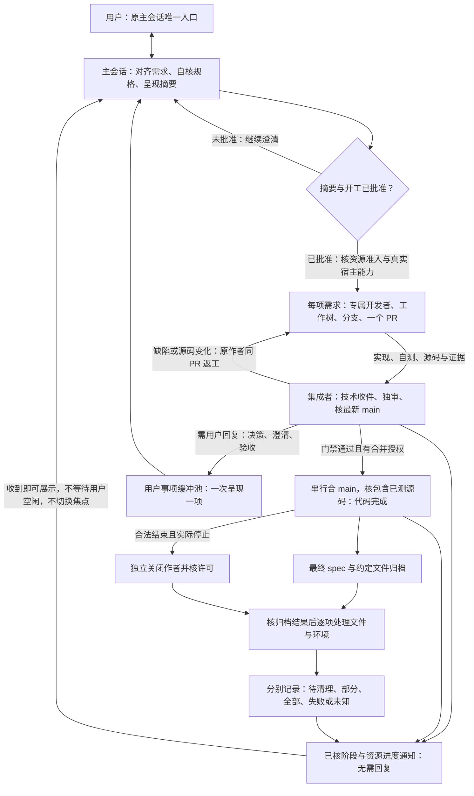

# 工作流

STATE-TOOL 的[职责受限状态与反馈入口](../skills/isolated-parallel-development-coordination/references/task-state.md)已提供；RESOURCE-FLOW 候选提供[独立资源入口](resource/resource-flow.md)，文件回收消费已实际合 main 的 ARCHIVE-TOOL 结果；不以流程图或隔离夹具宣称生产闭环通过。

用户始终留在原主会话。主会话整理业务需求和审批摘要；开发者按需求独立实现；唯一集成者完成技术审核及授权交付。

已确认的六职责和六步任务流程见[插件模块职责与接口设计](design/plugin-module-architecture.md)，技术细化见[工具接口与接续设计](design/tool-interface-contracts.md)及[验收清单](acceptance/tool-workflow-checklist.md)。这些文档区分目标设计与当前实现，当前运行规则仍以下述流程及共同规则为准。

图中每条执行路径都受当前授权和真实工具能力约束；资源不足会排队，缺宿主能力会受阻。图表示角色职责，不保证宿主自动调度或空闲唤醒。开发者不独审自己、不自合并、不创建替代用户聊天。

## 两条反馈通路

- **需要回复**：决策、业务澄清、验收进入用户事项缓冲池。主会话一次只呈现一项；技术失败先由作者和集成者排查，真正未决才交用户。
- **无需回复**：开发交付、独审、合入和资源回收等已核变化，由集成者沿已授权通路交原主会话，收到即可展示。已有待回答事项不挡住进度展示，通知也不改变当前焦点或授予权限。

发送接受、对方确认、真实终态、账本登记和用户看到通知是不同事实。空闲自动唤醒尚未实现；下一次可执行工作周期可以恢复未展示通知，不运行后台轮询。实现细节见[阶段反馈契约](../skills/isolated-parallel-development-coordination/references/stage-feedback.md)。

## 代码完成之后

合入 main 并核包含关系后，代码任务才完成。新入口将作者关闭和文件清理分开：关闭核合法结束、停止与真实身份；文件仍按真实归档结果保护。ARCHIVE 尚有未完成文件时保护相应目录并返回待办；旧 preservation 接口保留原门禁，不批量迁移历史任务。

回收按资源登记归属和具体授权逐项处理。共享资源、保护项、仍有活动工作或其它使用者的资源保留；关闭失败或结果未知保持待清理和责任者。目录消失、idle、任务 completed 或发送 close 请求都不证明原生关闭、名额或 RAM 已释放。合入完成通知与资源回收通知分别反馈，不把前者写成全部工作结束。

执行时从 [SKILL](../skills/isolated-parallel-development-coordination/SKILL.md)选择[主会话](../skills/isolated-parallel-development-coordination/references/roles/main.md)、[开发者](../skills/isolated-parallel-development-coordination/references/roles/developer.md)或[集成者](../skills/isolated-parallel-development-coordination/references/roles/integrator.md)指引；公共边界见[共同规则](../skills/isolated-parallel-development-coordination/references/current-rules.md)，能力限制见[平台边界](../skills/isolated-parallel-development-coordination/references/platform-boundary.md)。
